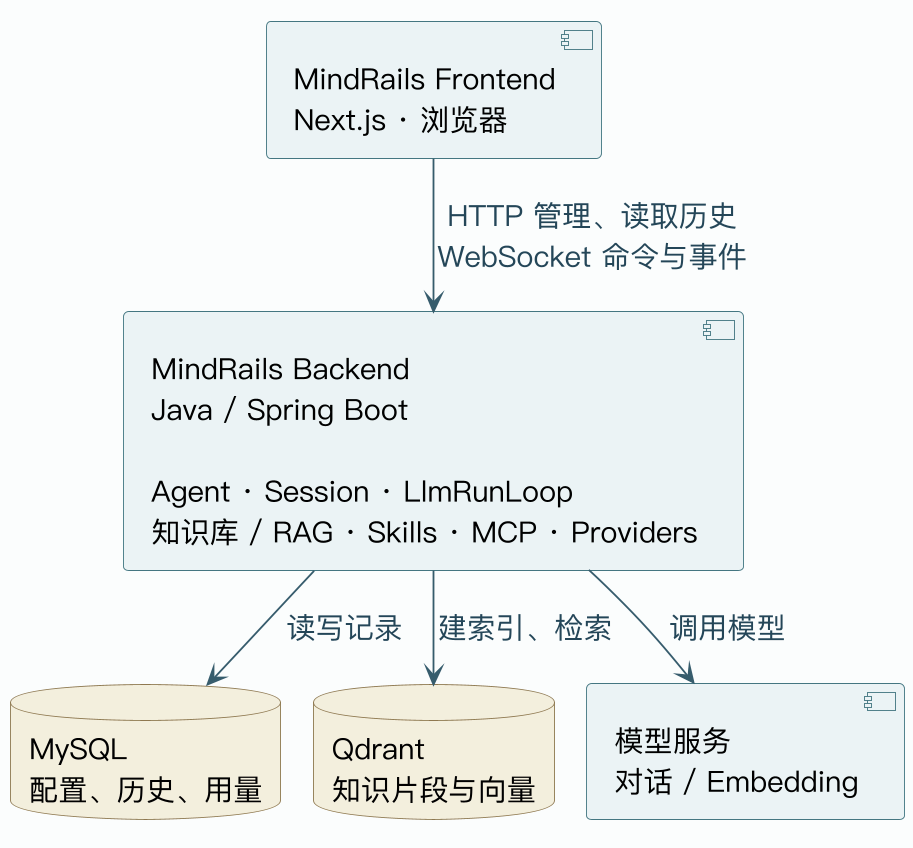
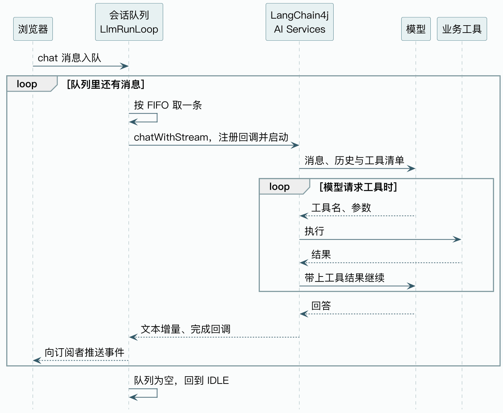

# 如何快速做一个完整的 Agent Platform

Yuchen，Architect & Builder | AI · Software · Cloud @ Shanghai

## Brief

我平时写代码用 Codex，上班用公司授权的 Cursor 和 Copilot。用久了，排项目计划、看合同，连家里的账也会丢给 Agent。OpenAI 管 Codex App 叫 “a command center for agents”，我可以开几个 Agent，让它们各干各的活，回来翻翻结果，接着交代下一件事。这类软件也有人叫 Agent Workspace，下面我统一叫 Agent Platform。[OpenAI 对 Codex App 的介绍](https://openai.com/index/introducing-the-codex-app/)

我用 vibe coding 做了一个类似 Codex 的 Web 应用，叫 MindRails。做这个 MVP，最费心思的是那些在演示里一闪而过的事。比如 Agent 说「已经发给对方了」，我到底该在页面上显示什么？默认你已经熟悉 Agent、Skill 和 MCP。

## 自己做 MindRails 的起因

有件事我到现在还得找人。我想知道一笔采购订单（PO）的货到了没有，记录在同事那里，我得把 PO 号发给他，等他查完回我。就算两个人都用上了 Agent，中间还是我俩在传话。我希望能把 PO 号直接发给他的 Agent，让它按权限查，把我能看的结果带回来。

我喜欢 Codex 的操作方式，做图又想用 Nano Banana，给中文文档建索引还想自己挑 embedding 模型。厂商把自己的模型接得最顺，这我能理解。可换个开源客户端，公司自己的 Microsoft 365 和内网里的 SAP 还是得接，谁能查哪些记录也得管。

给团队算钱时，我更习惯看 token，用量乘单价就能算。按 credit 扣费，拿到账单还得弄明白一个 credit 买到了什么。席位也是一笔钱。现场同事偶尔申请备件、查张工单，为这几次使用给每个人订一个开发工具，钱花得有点冤。

我动手写 MindRails，更多还是好奇。在 Codex 里交代一句就能办的事，自己从头做一遍要写多少东西？MindRails 目前是个 MVP，后端已经按 MIT 许可开源，可以拿去自己部署。[MindRails 后端仓库](https://github.com/yc-zhang/mindrails-backend)

## 需求说明

我先定下来的是浏览器。给程序员分享一个 Skill，告诉他放哪个目录就行。给采购同事，我希望发个链接，他用自己的账号登录，填个单号就能查。坐在办公室用电脑，去库房验收用手机。同一套应用，团队可以部署在内网，以后也可以做成 SaaS。

平台要能跑多个 Agent，各自配工具、Skills 和知识库。采购用的那个读验收规则、查订单，同事下周追这笔货，还能翻到上次的记录。写报告的那个可以翻项目资料、做 web 搜索，交回来的 Markdown 或 HTML 直接在浏览器里看。

模型由团队自己配。公司已经付过钱的 API 额度，我想先用起来；内网上有了私有模型，也能拿几份内部资料试试。每次调用记下模型和 token 用量，下次有人问写一份报告花多少钱，我能照着记录算给他看。

## 技术栈的选型

动手之前，有件事我一直很好奇。模型的输入是消息，输出也是消息，可我让它做一份报告，最后怎么就有个文件可以下载了？我去翻 OpenClaw 和 Pi 的实现，才发现自己一直盯着模型看，漏看了给模型递纸条的那段代码。

从调用者这边看，LLM 有点像思想实验里的「中文房间」（Chinese Room）。我从门缝塞进去一张纸条，过一会儿，里面递出来另一张。拿刚才的 PO 举个例子，假设平台给模型的工具清单里有个 `lookup_po`，写明了它查采购单，参数是订单号。这几张纸条大约长这样：

> 同事 → 模型：帮我看一下 PO-1042 到货了没。
>
> 模型 → 平台：调用 `lookup_po`，参数是 `{"number":"PO-1042"}`。
>
> 平台 → 模型：订了 10 台，仓库已签收 8 台。
>
> 模型 → 同事：到了 8 台，还有 2 台待收。

第二张纸条出来的时候，SAP 里一条数据都还没读。平台收到工具名和参数，才用当前用户的权限去查，把结果放回对话，再请模型接着答。这一来一回就是一次 tool call。模型还需要别的数据，就再跑一轮。**你告诉它手上有哪些工具，它就可以请你用这些工具干活。** 接上 bash，它可以请平台跑命令；接上 search，它可以请平台联网找资料；文件工具写好报告，平台就可以把它作为附件交给用户。Skill 可以把团队验收货物的步骤写给它看，MCP 可以把另一个系统里的查询工具接进来。到了查单这一步，干活的仍然是门外的程序。

### 四个项目怎么选

我拿同一件事来比：给同事做一个能查 PO 的助手。选哪一个，第一天能跑起来的东西差别挺大。

| 项目 | 拿到手的是什么 | 它替我省的活 | 放进 MindRails 的代价 |
| --- | --- | --- | --- |
| OpenClaw | 能直接用的助手，TypeScript | Gateway 已经接好 Telegram、Slack 和 WebChat，能把回答送回原来的对话 | 我只需要浏览器入口。想单独复用它的执行逻辑，得先理清渠道、路由和会话之间的依赖 |
| Pi | 终端里的 coding agent，也提供 SDK | 加一个查单工具，就能跟着一轮调用看清模型收了什么、工具回了什么 | 嵌入 Web 应用后，谁能用这个工具、哪些操作要用户确认，都得自己定 |
| Rig | Rust 库 | 用 `Tool` 声明参数、返回值和错误类型。参数解析成功才进入业务函数，工具结果由框架送回模型 | 如果查询逻辑已经在 Java 里，接进 Rust 还要处理服务调用和身份传递。已有 Rust 后端的团队会省事得多 |
| LangChain4j | Java 库 | AI Services 把模型、历史和工具装到一个 Java 接口后面，现有 Spring 服务可以直接拿来写工具 | 多个用户共用时，得自己管每个 Session 用哪份历史、哪些工具，以及用哪个模型 |

我最喜欢读的还是 Pi。第一次翻它的源码，我顺着 `agent-loop.ts` 看下去，再回头看消息类型和转换函数，模型跟工具之间那几张纸条就对上了。Pi 官网也把 OpenClaw 列作 SDK 的集成例子。要读一个 Agent 怎么跑，我会从 Pi 开始；想知道消息怎么从聊天软件一路送到 Agent，再看 OpenClaw 的 Gateway。写 Rust 的朋友可以直接看 Rig 的工具示例，加法函数那么几行代码就把参数解析和多轮调用讲明白了。[Pi](https://pi.dev/) · [OpenClaw Gateway](https://docs.openclaw.ai/concepts/architecture) · [Rig 工具示例](https://rig.rs/docs/concepts/tools/)

MindRails 最后用了 LangChain4j。以前用过它的同学可能还记得 Chain，现在官方文档已经把早期的 Chains 标成 legacy。我用的是 AI Services。`LlmClientFactory` 给每个会话配好模型、消息历史和可用的工具。要再接一个内部系统，我可以直接在 Java 里查权限、调现有的 service、跑测试。[LangChain4j AI Services](https://docs.langchain4j.dev/tutorials/ai-services/) · [MindRails 的 LlmClientFactory](https://github.com/yc-zhang/mindrails-backend/blob/main/src/main/java/com/mindrails/backend/agent/service/internal/llm/LlmClientFactory.java)

## 实际的架构设计

我把前后端拆成了两个应用。前端用 Next.js，同事在浏览器里选 Agent、开 Session、看结果。浏览器直接连 Spring Boot 后端。建 Agent、改 Provider、翻昨天的对话，走 HTTP 就挺好。到真正聊起来，我希望工具刚开始查单的时候，页面上就能看见它在查，模型边答，字也边出来，这段走 WebSocket。用户点「停止」，命令也从这条连接往回发。[前端会话连接](https://github.com/yc-zhang/mindrails-frontend/blob/main/src/lib/backend-session-stream.ts)

后端里，Agent 定义这个助手是干什么的，Session 则是跟它办的某一件事。模型从 Providers 里选，工作步骤放在 Skills 里，外部工具可以通过 MCP 接进来。拿采购举例，查订单状态要访问业务系统，查「这批货应该按哪一版规则验收」就得翻资料了。知识库给文档片段做 embedding，检索时从 Qdrant 取回相关片段，供模型回答时参考。至于这次是谁问的、用了哪个模型、花了多少 token，连同 Agent 配置和对话历史，都有 MySQL 里的记录可查。[后端与存储配置](https://github.com/yc-zhang/mindrails-backend/blob/main/README.cn.md) · [数据库表](https://github.com/yc-zhang/mindrails-backend/blob/main/db/schema.sql)

### 后端的 Agent Loop

写到 Session，我碰到一个比查单更有意思的问题。假设第一句话是「帮我查这笔 PO」，工具还在跑，我又补了一句「顺便看看上周那批」。页面随后被我关了。第二句话谁收着？第一笔查询还要不要继续？我把这段逻辑放到了后端，每个活跃的 Session 有自己的 `LlmRunLoop`，持有一个客户端、一条先进先出的消息队列，还有当前订阅事件的连接。

第一句话入队，状态从 `IDLE` 变成 `RUNNING`，执行器启动 `runAgentLoop`。它取出队首，记下这次运行，调用 `chatWithStream`，挂好回调再启动流。模型要查单，LangChain4j 就执行工具、把结果带回去，直到模型给出回答。期间工具开始、工具结果、文本增量都会作为事件发给订阅者。第二句话这时只管排队，等第一条结束才轮到它。队列空了，循环退出，Session 回到 `IDLE`。[LlmRunLoop 源码](https://github.com/yc-zhang/mindrails-backend/blob/main/src/main/java/com/mindrails/backend/agent/service/internal/LlmRunLoop.java)

关网页只会少一个订阅者，后端接着干活。点「停止」才有不同：后端取消当前执行，把排队的消息取出来，标记它们还没执行，留作下一次对话的上下文。这样我回来补一句「只查今天这批」，上周那批也不会自己跑起来。如果是模型请求报错，这轮失败，积压的消息也会收到失败事件。普通错误后会话可以接新消息；碰到执行器拒绝启动这类故障，循环进入 `DOOMED`，后续入队会被拒绝。这个区别在只有一个聊天框的时候看不太出来，开两个页面盯着同一件事，就很容易感觉到了。[会话执行与并发测试](https://github.com/yc-zhang/mindrails-backend/blob/main/src/test/java/com/mindrails/backend/agent/service/LoopSessionConcurrencyTest.java)

## 让两个 Session 一起干活

11 月 7 日我给 MindRails 加会话通信时，手上已经有现成的队列了。一个 Session 能收我从浏览器发来的消息，那另一个 Session 也应该能给它递一条。拿前面那笔采购单举个例子：假设我自己的账号下开了两个会话，一个写项目周报，一个跟采购。写周报的 Agent 手上缺交货数字，我希望它能去问采购那个，省得我来回复制两遍。

我给它两个工具。先用 `session_list` 按标题找会话，拿回准确的 Session ID、会话名和 Agent 名。假如有两个都叫「采购」，把名字列出来让我挑就好。选好以后，`session_communicate` 发过去的正文可以很短：

> 帮我查一下 PO-1042 已签收多少台。把数量和查询时间回给这个会话，我要写进周报。

返回值里有 `enqueued`、消息 ID 和目标 Session ID。这时候周报上还不能填数字，只能说请求已经送到队列了。采购会话空闲就开工，忙就排队，即使它的页面早关了也照常处理。发过去的是这段文字，采购 Agent 仍用自己的历史和工具。查完以后，它要用同一个工具往回发，把原消息 ID 填到 `inReplyTo`。如果它只在自己的对话里说「到了 8 台」，写周报的那个还是什么都不知道。回信来了，周报会话的队列自然会被唤醒，我也就省下了一个专门等结果的状态。[会话发现工具](https://github.com/yc-zhang/mindrails-backend/blob/main/src/main/java/com/mindrails/backend/agent/tool/SessionListTool.java) · [消息投递与回执](https://github.com/yc-zhang/mindrails-backend/blob/main/src/main/java/com/mindrails/backend/agent/service/SessionCommunicationService.java)

把发消息做成 tool，有个很实际的好处。模型读到「把结果回给我」时，可以在查单之后自己选这一步；换成「这个新交期你记一下」，收到的人就可以到此为止。后端负责检查两边都是同一用户的普通 Session，记录消息从哪里来。同一次 Run 里，重复的 tool call 用原来的回执，避免一笔单被派两次。消息链最多走 8 跳，否则两个过于客气的 Agent 光互相确认收到了，就有活干了。[通信工具契约](https://github.com/yc-zhang/mindrails-backend/blob/main/src/main/java/com/mindrails/backend/agent/tool/SessionCommunicationTool.java)

### 从 Codex 给家里的 WorkBuddy 留个活

这才是我接下来想做成产品的部分。比如我在 Codex 里写一份家庭开支分析，票据都在家里的电脑上。我想交代一句：「让家里的 WorkBuddy 把这个月的电费单找出来，把月份和金额回给我。」WorkBuddy 在家里读票据，Codex 在我这里接着算。各自在已经有权限的地方干活，两边只交换这次需要的几个数。

MindRails 现在解决的是一个平台内、我自己的会话互通。换成两个 Agent App，连「家里的 WorkBuddy」指的是谁都要重新解决。如果让我做第一版，我会先让用户配对两个端点，给这次委托一个两边都认的消息 ID。家里的机器可能关着，Codex 应该能看出消息还在等投递、对方已接手，还是已经有了结果。回信带原 ID，断线重连后也认得出这是上次那笔活。能把这一趟跑顺，我才想试着同时派两件事，再让发起方收齐结果。至于开篇那个「找同事的 Agent 查 PO」，还多一层同事愿意替谁查、哪些字段可以回给对方的授权。这个才是从自己用走到团队用要补的设计。

## 工具、Skill 和 MCP 怎么接

LangChain4j 让一个 Java 方法出现在模型的工具清单里挺方便，加上 `@Tool`，写好参数和说明，就有了入口。设计工具时我更关心返回什么。模型拿到这个返回值，够不够它决定下一步要做什么？刚才的 `enqueued` 就是个例子，如果我图省事只回一句 `success`，模型很容易把「投递成功」写成「工作完成」。

文件操作我留了 `ls`、`find`、`grep`、`read`、`write` 和 `edit`。找一个文件、读其中一段、改几行字，都有直接的做法；真要跑脚本，再交给 shell。查外部资料是另一个动作，`web_search` 接当前启用的搜索服务，把来源链接带回来。没有配置搜索服务就返回错误。对写报告的 Agent 来说，「我没能搜索」和「我搜过，这次没有找到」会写出两份很不一样的报告。[文件工具注册](https://github.com/yc-zhang/mindrails-backend/blob/main/src/main/java/com/mindrails/backend/tool/CompositeToolConfiguration.java) · [Web Search 的工具说明](https://github.com/yc-zhang/mindrails-backend/blob/main/src/main/java/com/mindrails/backend/tool/web/WebSearchTool.java)

附件最能说明我为什么把能力放在工具这一层。假设 Agent 已经写好了 `report.html`，回我一句服务器上的路径，我在手机上点得开吗？我给文件工具加了个 `SessionDeliverableToolAdapter`。相对路径落到这个会话的输出目录，`write` 和 `edit` 先写临时文件，成功后移到目标位置，再为交付文件登记下载链接。用 shell 生成文件也一样，命令成功结束才登记。模型把工具实际返回的链接贴给我就行。用户发进来的附件走另一个入口，聊天消息带文件版本 ID，后端把选中的附件挂到这次调用上。这样「读用户给的文件」和「把做好的文件交给用户」两件事都找得到出处。[文件交付适配器](https://github.com/yc-zhang/mindrails-backend/blob/main/src/main/java/com/mindrails/backend/asset/tool/SessionDeliverableToolAdapter.java)

这个思路让我想到 DeepSeek Harness 讲的 “everything is a plugin”。在 MindRails 里，发消息和交文件也能沿用已有的工具调用过程。前者做到入队，回一个消息 ID；后者做到发布，回一个下载链接。会话循环只要知道工具什么时候开始、什么时候返回，还要不要把结果交给模型。它用不着知道一份 HTML 是怎么登记的。[DeepSeek Harness](https://github.com/deepseek-ai/deepseek-harness)

Skill 和 MCP 我主要管谁能看见、谁能调用。普通 Session 从当前用户的目录发现 Skills，先给模型名字和说明，用到再通过 `activate_skill` 读具体做法。定时或独立执行的 Task 只装选中的 Skill ID。MCP 这边，普通会话发现的是当前账号已启用的连接，Task 则按所属 Agent 的连接配置取用。真正调工具之前，服务端会再算一次允许访问的范围。比如我刚把一个连接关掉，上一轮出现在模型上下文里的工具名，不能当成这一轮的通行证。[SkillCatalog](https://github.com/yc-zhang/mindrails-backend/blob/main/src/main/java/com/mindrails/backend/skill/SkillCatalog.java) · [MCP 授权](https://github.com/yc-zhang/mindrails-backend/blob/main/src/main/java/com/mindrails/backend/mcp/service/McpToolAuthorization.java)

## 其他值得看的开源 Agent

如果你也想做个类似 Codex 的应用，我会带着一个小问题去看现成产品。下面三个各有一处值得借。

- **OpenCode** 可以从终端、桌面或 Web 使用。做浏览器入口时，可以拿它看一遍同一个编码任务在不同客户端里怎么操作，哪些交互真的需要留在网页上。[OpenCode 文档](https://opencode.ai/docs/)
- **Cline** 适合看工具执行前的确认。让它在编辑器里改个文件、跑条命令，留意它把哪些信息展示给用户再请人点头。这跟采购助手执行一次写操作前要展示什么，是同一个设计问题。[Cline 项目](https://github.com/cline/cline)
- **Aider** 把代码修改和 Git 放得很近。让它改一次代码，再看 diff、看提交、试一次撤销。要设计一个允许 Agent 动用户文件的工具，这段体验比只看它改得对不对更值得花时间。[Aider 的 Git 集成](https://aider.chat/docs/git.html)

## 我怎么做 vibe coding

**先定接口，再让模型写实现。** 一个功能决定要做，我会从外往里写：Controller 接什么、返回什么，WebSocket 的命令和事件长什么样，service 承诺做到哪一步，下面哪个 component 去干活。像发消息这种，给 LLM 看一组「A 发出请求、B 已入队、B 稍后回信」的输入输出，比写一句「支持多 Agent 协同」省事得多。实现也给一个我愿意继续维护的例子：依赖从构造器传进来，错误在哪一层处理，方法叫什么。显式优于隐式，Clean Code 到了这里，就是下次我能顺着这些名字把代码读回来。

**代码得长在人还能管得住的范围里。** 我自己的反例就是 `LlmClientFactory`。最开始只是组装模型和工具，后来历史、Skills、检索、监听器、不同 Provider 的兼容处理都往里加。每一轮单看都讲得通，叠在一起，我一直没腾出精力把它收拾到满意。现在我看一轮改动，会问自己：明天在这里换一种工具，我知道从哪儿下手吗？哪块写得不好，我说得出来吗？真要重构，我敢动吗？已经答不上来的地方，我宁可把下一轮留给重构。

**每轮收工前，实际走一次功能。** 我时间有限，MVP 阶段做不到把生成的代码逐行 review 完。会话通信那轮，我在集成测试里让 A 发给 B，B 连网页都没开，再让 B 回给 A。用本地可控的模型把往返跑完，查回信进了哪个队列，再看两边的历史有没有串。到了文件交付，验收就得换个办法：在浏览器里点开报告。后端写出文件、测试全绿，都替不了这一下。

**想到什么就写，别省提示词。** 我在会话通信的设计稿里专门留了两句话，一句是「检查完把结论发回来」，另一句是「这个数字改成 42，供后续使用」。就这么一点区别，决定了对方要不要回信，也省掉了一个双方互相等的状态。我愿意把这些例子、反例和没想明白的地方一块儿写进去。第二天再开一个对话，模型知道我要它做什么，我也记得昨天为什么这么定。

## 小结

翻回 MindRails 的设计记录，8 月那份产品定义里，我想的是怎么让团队把一个人的 Agent 做出来，给别人演示、分享、接着用。到了 10 月 29 日，我在文档里列的却是批作业、查库存、确认流程，还特意给自己留了句「我自己日常也要用起来」。中间写过不少看着很像定稿的 API、重构计划、验收记录。隔两周再翻，最有用的往往是当时多记的一句：文件已经能上传了，但是生成的报告还得去浏览器里点点看。

11 月 7 日记下来的那个小进展，我现在还挺喜欢：A 把活发出去，没有开页面的 B 能接，做完又能把话带回来。一开始做 MindRails，我好奇的是模型怎么把一件事做完。做完这个 MVP，我最想继续琢磨的，倒是手边的 Codex 怎么把一件事交给家里的 WorkBuddy，等我下次打开电脑，回信正好在那里。
