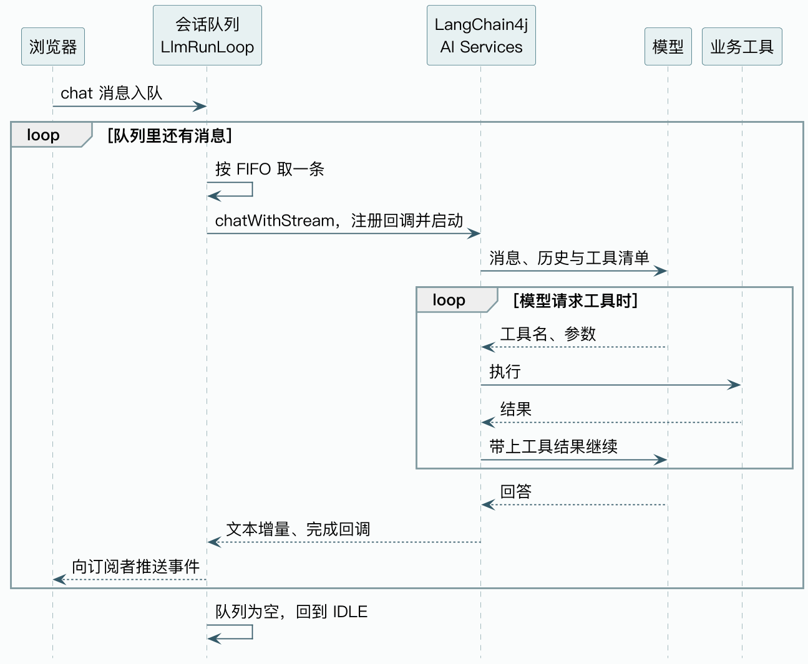
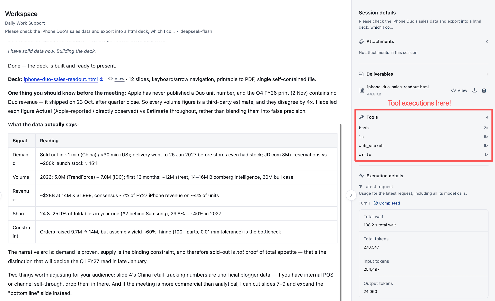

# Agent 是如何“做事情”的

今年我用 Codex、Cursor、Copilot 和 OpenClaw 写了不少代码，一直好奇一件事。让 LLM 写个函数，它能把代码贴给我，这个我懂。可我切回 IDE，那个文件已经改好了，连测试都跑过了。那么是谁动的手呢？

我喜欢把 LLM 想成一个中文房间。我往里递张纸条，里面回我一张。现在我要它给网页截个图，调一下窗口大小，甚至在 iOS 模拟器里帮我点份外卖，总得有人在房间外面替它点那一下。软件行业没有免费的午餐。于是我看了 OpenClaw 和 Pi 的工具实现，想搞清楚它们是怎么“操作”我的电脑的。[Pi 的写文件工具](https://github.com/earendil-works/pi/blob/d4760131efe0740b9b7f7ad1f126734b96a011c0/packages/coding-agent/src/core/tools/write.ts) · [Pi 的 Agent Loop](https://github.com/earendil-works/pi/blob/d4760131efe0740b9b7f7ad1f126734b96a011c0/packages/agent/src/agent-loop.ts)

## 我们用搜索球赛举例

假设我给自己的 Agent 写了个 `web_search` 函数。给它关键词和页码，它就去调我配好的搜索 API。我在聊天框里问「本周末的英超有哪些比赛？」Agent 发给模型的请求里，比我打的字多了一样东西。下面只摘跟这次调用有关的字段。

```json
{
  "messages": [{"role": "user", "content": "本周末（11 月 28、29 日）的英超有哪些比赛？"}],
  "tools": [{
    "type": "function",
    "function": {
      "name": "web_search",
      "description": "按关键词搜索网页，返回标题、链接和摘要。",
      "parameters": {
        "type": "object",
        "properties": {
          "keyword": {"type": "string"},
          "page": {"type": "integer", "minimum": 1}
        },
        "required": ["keyword", "page"]
      }
    }
  }]
}
```

模型看完，第一轮可以先回这么一张纸条。

```json
{
  "role": "assistant",
  "tool_calls": [{
    "id": "call_1",
    "type": "function",
    "function": {
      "name": "web_search",
      "arguments": "{\"keyword\":\"Premier League fixtures 28 29 November 2026\",\"page\":1}"
    }
  }]
}
```

这时候，一次搜索都还没发生。Agent 收到 `tool_calls`，按名字找到我写的函数，解析参数，去搜第一页。在这个例子里，调用 `web_search` 就是 Agent 在自己的进程里调一个方法。你可以按名字动态查找，也可以直接写个 `switch`，怎么调由你实现。

搜回来的网页摘要装进一条 `role: "tool"` 的消息，标上 `tool_call_id: "call_1"`，连同前面的对话一起发回去。要是第一页只列了周六的比赛，模型还可以接着要第二页。等拿到两天的赛程，它才有材料告诉我周日晚上能看哪场球。

这就是 function calling。下面这张图是我做 [MindRails](https://github.com/yc-zhang/mindrails-backend) 时画的。沿着「模型请求工具时」框里的四根箭头走一圈，就是刚才查一页赛程的过程。



## 回到让 AI 写代码的这件事儿上

我自己改一个 JS 项目，通常先找文件，搜一下函数在哪儿用，读几行，再动手改。于是做 MindRails 的时候，我用 Java 给 Agent 配了这么几个工具。

- `FindTool` 按文件名模式找文件，比如 `**/*.js`。
- `GrepTool` 搜文件内容，比如谁调用了 `getSchedule`。
- `ReadTool` 把文件里的代码读回来。
- `EditTool` 找到一段原文，换成改好的代码。
- `WriteTool` 新建文件，或者整份重写。

拿最后一个来说，模型在参数里给出路径和完整代码，对应的 Java 方法把代码写进文件。你要是好奇那个「动手」的瞬间，点开 `WriteTool` 就能看到。[WriteTool.java](https://github.com/yc-zhang/mindrails-backend/blob/main/src/main/java/com/mindrails/backend/tool/spec/WriteTool.java) · [GrepTool.java](https://github.com/yc-zhang/mindrails-backend/blob/main/src/main/java/com/mindrails/backend/tool/spec/GrepTool.java)

还差一步，测试怎么跑？我又加了个 `BashTool`，让它在指定目录执行命令。模型可以先要 Agent 跑一次 `pnpm test`，读到哪个断言失败了，再用 `edit` 改那几行，重新跑。开头我在 IDE 里看到的那次改动，有这么几个工具就做得出来。



上图是我让 MindRails 查资料、做一份 HTML 演示稿的记录。聊天框里给了我一个文件。展开右边的 Tools，这趟它搜了 6 次网页，列了 5 次目录，跑了 2 次 bash，写了 1 次文件。

从模型这头看，skill 里的步骤、通过 MCP 拿到的工具说明，都可以当作 prompt 来读。它们告诉模型有哪些工具、什么时候用、参数怎么填。

做 Agent 时，架构师要决定哪些事交给模型临场处理，哪些事值得写进工具里。比如读 PDF，给模型一个通用的 `bash`，它就能自己挑命令，但也得自己弄清楚怎么取第 3 页。如果团队天天都要按页看 PDF，我会写个 `pdf_viewer`，让模型传文件名和页码就行。代价是以后 PDF 渲染出了问题，这个工具也得由我来维护。

**开发建议：** Pi、Rig 和 LangChain4j 都定义了自己的工具接口。如果你也在开发 Agent，可以挑一个熟悉的库，顺着它的例子看两处：工具的名字和参数是怎么告诉模型的，模型返回一次调用请求后，框架又是怎么找到你写的函数的。[Pi](https://docs.pi.dev/latest/extensions#custom-tools) · [Rig](https://rig.rs/docs/concepts/tools/) · [LangChain4j](https://docs.langchain4j.dev/tutorials/tools)

---

Yuchen，Architect & Builder | AI · Software · Cloud @ Shanghai

最近在做 MindRails，一个给小团队用的 Agent Platform，目前还是 MVP，完全开源。[MindRails on GitHub](https://github.com/yc-zhang/mindrails-backend)。
