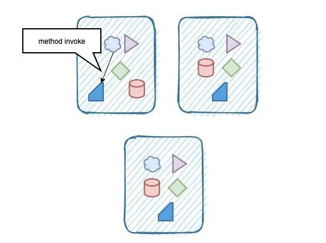
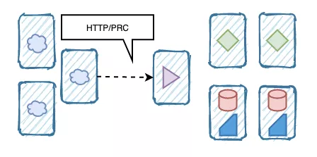
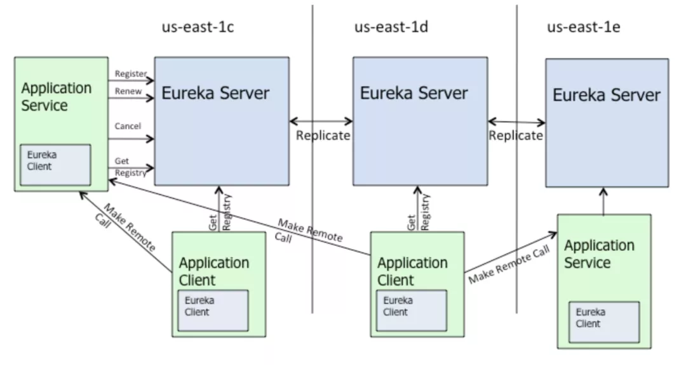
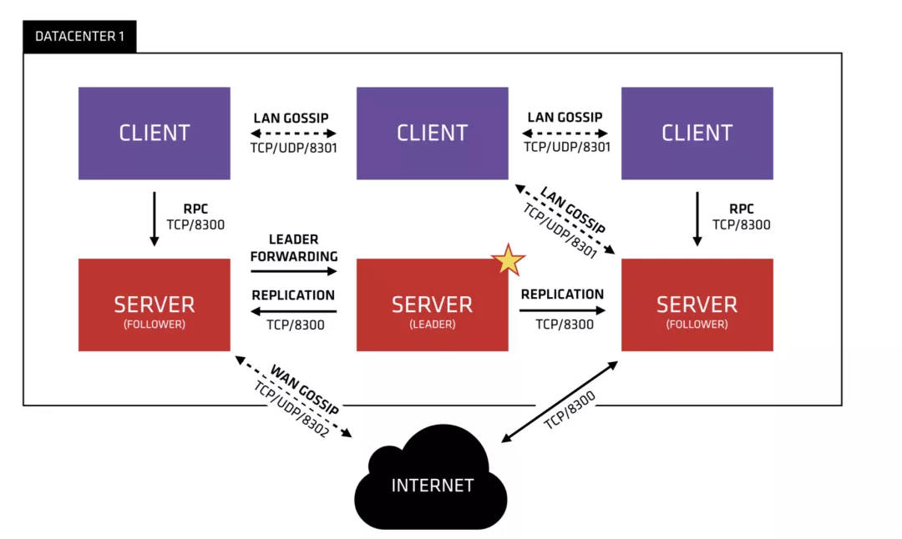
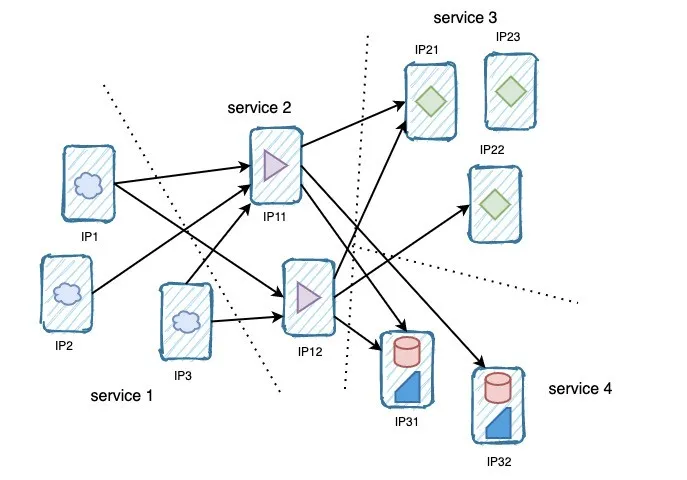
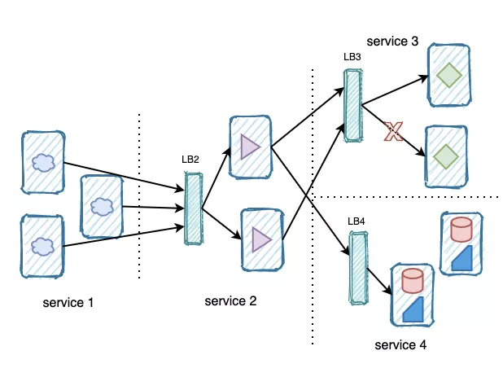

# 服务发现技术选型那点事儿

发表于 2020-10-10 · [阿里云开发者社区原文](https://developer.aliyun.com/article/775388)

作者 | Yuchen

## 引子——什么是服务发现

近日来，和很多来自传统行业、国企、政府的客户在沟通技术细节时，发现云原生所代表的技术已经逐渐成为大家的共识，从一个虚无缥缈的概念渐渐变成这些客户的下一个技术战略。自然，应用架构就会提到微服务，以及其中最重要的分布式协作的模式——服务发现。模式（pattern）是指在特定上下文中的解决方案，很适合描述服务发现这个过程。不过相对于 2016 年，现在我们最少有十多种的方式能实现服务发现，这的确是个好时机来进行回顾和展望，最终帮助我们进行技术选型与确定演进方向。

微服务脱胎于 SOA 理论，核心是分布式，但单体应用中，模块之间的调用（比如让消息服务给客户发送一条数据）是通过方法，而所发出的消息是在同一块内存之中，我们知道这样的代价是非常小的，方法调用的成本可能是纳秒级别，我们从未想过这样会有什么问题。但是在微服务的世界中，模块与模块分别部署在不同的地方，它们之间的约束或者协议由方法签名转变为更高级的协议，比如 RESTful 、PRC，在这种情况下，调用一个模块就需要通过网络，<strong>我们必须要知道目标端的网络地址与端口，还需要知道所暴露的协议，然后才能够编写代码比如使用 HttpClient 去进行调用，这个“知道”的过程，往往被称为服务发现。</strong>

分布式的架构带来了解耦的效果，使得不同模块可以分别变化，不同的模块可以根据自身特点选择编程语言、技术栈与数据库，可以根据负载选择弹性与运行环境，使得系统从传统的三层架构变成了一个个独立的、自治的服务，往往这些服务与业务领域非常契合，比如订单服务并不会关心如何发送邮件给客户，司机管理服务并不需要关注乘客的状态，这些服务应该是网状的，是通过组合来完成业务。解耦带来了响应变化的能力，可以让我们大胆试错，我们希望启动一个服务的成本和编写一个模块的成本类似，同时编写服务、进行重构的成本也需要降低至于代码修改一般。在这种需求下，我们也希望服务之间的调用能够简单，最好能像方法调用一样简单。

但是 Armon（HashiCorp 的创始人）在他的技术分享中提到，实现分布式是没有免费午餐的，一旦你通过网络进行远程调用，那网络是否可达、延迟与带宽、消息的封装以及额外的客户端代码都是代价，在此基础上，有时候我们还会有负载均衡、断路器、健康检查、授权验证、链路监控等需求，这些问题是之前不需要考虑的。所以，我们需要有“产品”来帮助我们解决这类问题，我们可以先从 Eureka 开始回顾、整理。

一个单体应用部署在多台服务器中，模块间通过方法直接调用。

分布式的情况下，模块之间的调用通过网络，也许使用 HTTP 或者其他 RPC 协议。

## Spring Cloud Eureka

从 Netflix OSS 发展而来的 Spring Cloud 依旧是目前最流行的实现微服务架构的方式，我们很难描述 Spring Cloud 是什么，它是一些独立的应用程序、特定的依赖与注解、在应用层实现的一揽子的微服务解决方案。<strong>由于是应用层解决方案，那就说明了 Spring Cloud 很容易与运行环境解耦</strong>，虽然限定了编程语言为 Java 但是也可以接受，因为在互联网领域 Java 占有绝对的支配地位，特别是在国内。所以服务发现 Eureka、断路器 Hystrix、网关 Zuul 与负载均衡 Ribbon 非常流行直至今日，再加上 Netflix 成功的使用这些技术构建了一个庞大的分布式系统，这些成功经验使得 Spring Cloud 一度是微服务的代表。

对于 Eureka 来说，我们知道不论是 Eureka Server 还是 Client 端都存在大量的缓存以及 TTL 机制，因为 Eureka 并不倾向于维持系统中服务状态的一致性，虽然我们的 Client 在注册服务时，Server 会尝试将其同步至其他 Server，但是并不能保证一致性。同时，Client 的下线或者某个节点的断网也是需要有 timeout 来控制是否移除，并不是实时的同步给所有 Server 与 Client。的确，通过“最大努力的复制（best effort replication）” 可以让整个模型变得简单与高可用，我们在进行 A -> B 的调用时，服务 A 只要读取一个 B 的地址，就可以进行 RESTful 请求，如果 B 的这个地址下线或不可达，则有 Hystrix 之类的机制让我们快速失败。

对于 Netflix 来说，这样的模型是非常合理的，首先服务与 node 的关系相对静态，一旦一个服务投入使用其使用的虚拟机（我记得大多是 AWS EC2）也确定下来，node 的 IP 地址与网络也是静态，所以很少会出现频繁上线、下线的情况，即使在进行频繁迭代时，也是更新运行的 jar，而不会修改运行实例。国内很多实现也是类似的，在我们参与的项目中，很多客户的架构图上总会清晰的表达：这几台机器是 xx 服务，那几台是 xx 服务，他们使用 Eureka 注册发现。第二，所有的实现都是 Java Code，高级语言虽然在效率上不如系统级语言，但是易于表达与修改，使得 Netflix 能够保持与云环境、IDC 的距离，并且很多功能通过 annotation 加入，也能让代码修改的成本变低。

Eureka 的逻辑架构很清楚的表达了 Eureka Client、Server 之间的关系，以及他们的 Remote Call 是调用的。

Eureka 的限制随着容器的流行被逐渐的放大，我们渐渐的发现 Eureka 在很多场景下并不能满足我们的需求。首先对于弱一致性的需求使得我们在进行弹性伸缩，或者蓝绿发布时就会出现一定的错误，因为节点下线的消息是需要时间才能同步的。在容器时代，我们希望应用程序是无状态的，可以优雅的启动和终止，并且易于横向扩展。由于容器提供了很好的封装能力，至于内部的代码是 Java 还是 Golang 并不是调用者关心的事情，这就带来了第二个问题，虽然使用 Java annotation 的方式方便使用，但是必须是 Java 语言而且需要一大堆 SDK，很多例如负载均衡的能力无法做到进程之外。Eureka 会让系统变得很复杂，如果你有十几个微服务，每个微服务都有四五个节点，那维护这么多节点的地址就显得非常臃肿，对于调用者来说它只需要关注自己所依赖的服务。

## Hashicorp Consul

Consul 作为继任者解决了很多问题，首先 Consul 使用了现在流行的 service mesh 模式，在一个“控制面”中提供了服务发现、配置管理与划分等能力，与 Netflix OSS 套件一样，任何的这些功能都是可以独立使用的，也可以组合在一起去构建我们自己的 service mesh 实现。Service mesh 作为实现微服务架构的新模式，核心思想在于进程之外 out-of-process 的实现功能，也就是 sidecar，我们可以通过 proxy 实现 interceptor 在不改变代码的情况下注入某些功能，比如服务注册发现、比如日志记录、比如服务之间的授信。

Consul 的架构更为全面并复杂，支持多 Data Center，使用了 GOSSIP 协议，有 Control Panel 提供 Mesh 能力，基本上解决为了 Eureka 的问题。

与 Eureka 不同，Consul 通过 Raft 协议提供了强一致性，支持各种类型的 health check，而且这些 health check 也是分布式的，也不需要使用大量的 SDK 来在代码中集成这些功能。由于 Consul 代理了流量，所以可以支持传输安全 TLS，在架构设计上 Consul 与 Istio 还是有所类似，但是的确还是有如下的不足：

- 没有提供 native 的方式去配置 circuit breaker，Netflix OSS suite 最大的优势是，EurekaHystrixRibbon 能够提供完整的分布式解决方案，特别是 Hystrix，能够提供“快速失败”的能力，但是 Consul 的话，目前还没有提供原生的方案。
- 同样的，集成 Consul 也变得比较麻烦，agent 的启动不是那么简单，特别是在 k8s 上我们需要多级 sidecar 时，同时其提供的 ACL 配置也难以理解和使用。相对于内部的实现，管控用的 GUI 界面也是大家吐槽比较多的地方。
- 相对于服务发现，其他 Consul 所提供的功能就显得不那么诱人了，比如 Key-Value 数据库以及多数据中心支持，当然我认为这也不是核心内容。
- 政治因素，虽然是开源产品，但是其公司也参与了对中国企业的制裁，所以在国内是无法合法使用该产品的。

## Alibaba Nacos

<strong>Nacos 已经是目前项目中的首选，特别是那些急需 Eureka 替代品的场景下，当然这不是因为我们无法使用 Consul，更多的是因为 Nacos 已经成为了稳定的云产品，你无需自己部署、运维、管控一个 Consul 或者别的机制，直接使用 Nacos 即可</strong>。

而且 Nacos 替代 Eureka 基本上是一行代码的事情，某些时候客户并没有足够的预算和成本投入微服务的改造与升级，所以在进行微服务上云的过程中，Nacos 是目前的首选。相对于 Consul 自己发明轮子的做法，Nacos 在协议的支持更全面，包括 Dubbo 与 gRPC，这对于广泛使用 Dubbo 的国内企业是一个巨大的优势。

在这里笔者就不扩展 Nacos 的功能与内部实现了，Nacos 团队所做的科普、示例以及深度的文章都已经足够多了，已经所有的文档都可以在官网找到，代码也开源，有兴趣的话请大家移步 Nacos 团队的博客：<https://nacos.io/zh-cn/blog/index.html>

## SLB、Kubernetes Service 与 Istio

实际上，我们刚才提到的“服务发现”是“客户端的服务发现（client-side service discovery）”，假设订单系统运行在四个节点上，每个节点有不同的 IP 地址，那我们的调用者在发起 RPC 或者 HTTP 请求前，是必须要清楚到底要调用个节点的，在 Eureka 的过程中，我们会通过 Ribbon 使用轮询或者其他方式找到那个地址与端口，并且发起请求。

这个过程是非常直接的，作为调用者，我有所有可用服务的列表，所以我可以很灵活的决定我该调用谁，我可以简单的实现断路器。但是缺点的话也很清楚，我们必须依赖 SDK，如果是不同的编程语言或框架，我们就必须要编写自己的实现。

像蜘蛛网一样的互相调用过程，并且每个服务都必须有 SDK 来实现客户端的服务发现，比如 IP3 这台机器，是由它来决定最终访问 Service 2 的那个节点。同时，IP23 刚刚上线，但是还没有流量过来。

但是在逻辑架构上，这个系统又非常简单，serivce 1 -> service 2 -> service 34。对于研发或者运维人员，你是希望 order service 是这样描述：

> <https://internal.order-service.some-company.com:8443/> - online

还是，这样一大堆地址，并且不确定的状态？

> <http://192.168.20.19:8080>  - online  
> <http://192.168.20.20:8080> - online  
> <http://192.168.20.21:8080> - offline  
> <http://192.168.20.22:8080> - offline

事实上断路器所提供的快速失败在客户端的服务发现中非常重要，但是这个功能并不完美，我们想要的场景是调用的服务都是可用的，而不是等调用链路走到个节点后再快速失败，而这时候另一个节点是可以提供服务的。

<strong>而且对于一个订单服务，在外来看它就应该是“一个服务”，它内部的几个节点是否可用并不是调用者需要关心的，这些细节我们并不想关心</strong>。

在微服务世界，我们很希望每个服务都是独立且完整的，就像面向对象编程一样，细节应该被隐藏到模块内部。按照这种想法，服务端的服务发现（server-side serivce discovery）会更具有优势，其实我们对这种模式并不陌生，在使用 NGINX 进行负载均衡的代理时，我们就在实践这种模式，一旦流量到了 proxy，由 proxy 决定下发至哪个节点，而 proxy 可以通过 healthcheck 来判断哪个节点是否健康。

逻辑上还是 serivce 1 -> service 2 -> service 34，但是 LB 或者 Service 帮助我们隐藏了细节，从 Service 1 看 Service 2，就只能看到一个服务，而不是一堆机器。

服务端服务发现的确有很多优势，比如隐藏细节，让客户端无需关心最终提供服务的节点，同时也消除了语言与框架的限制。缺点也很明显，每个服务都有这一层代理，而且如果你的平台不提供这样的能力的话，自己手动去部署与管理高可用的 proxy 组件，成本是巨大的。但是这个缺陷已经有很好的应对，你可以使用阿里云的 SLB 实现，不论 client 使用 HTTP 还是 PRC 都可以通过 DNS 名称来访问 SLB，甚至实现全链路 TLS 也非常简单，而 SLB 可以管理多个 ECS 实例，也支持实例的 health check 与弹性，这就像一个注册中心一样，每个实例的状态实际上保存在 SLB 之上。云平台本身就是利于管控和使用，加入更多的比如验证、限流等能力。

Kubernetes Service 也具有同样的能力，随着容器化的逐渐成熟，在云原生的落地中 ACK 是必不可少的运行环境，那通过 Service 去综合管理一组服务的 pod 与之前提到的 SLB 的方式是一致的，当然相对于平台绑定的 SLB + ECS 方案，k8s 的 service 更加开放与透明，也支持者企业进行混合云的落地。

作为 service mesh 目前最流行的产品，Istio 使用了 virtual service 与 destination rule 来解决了服务注册与发现的问题，virtual service 与其他 proxy 一样，都非常强调与客户端的解耦，除了我们日常使用的轮询式的调用方式，virtual service 可以提供更灵活的流量控制，比如“20% 的流量去新版本”或者“来自某个地区的用户使用版本 2”，实现金丝雀发布也比较简单。相对于 kubernetes serivce, virtual service 可控制的地方更多，比如通过 destination rule 可控制下游，也可以实现根据路径匹配选择下游服务，也可以加入权重，重试策略等等。你同样可以通过 Istio 的能力实现服务间的传输安全，比如全链路的 TLS，也可以做到细粒度的服务授权，而这所有的一切都是不需要写入业务代码中的，只要进行一些配置就好。但是这也不是免费的，随着服务数量的上升，手动的管理这么多的 proxy 与 sidecar，没有自动化的报警和响应手段，都会造成效率的下降。

## ZooKeeper 真的不适合做注册发现吗？

在微服务刚刚开始流行的时候，很多企业在探索的过程中开始使用 ZooKeeper 进行服务发现的实现，一方面是 ZooKeeper 的可靠、简单、天然分布式的优势可以说是直接的选择，另一方面也是因为没有其他的机制让我们模仿。下面这篇发布于 2014 年底的文章详细的说明了为什么在服务发现中，使用 Eureka 会是一个更好的解决方案。

<https://medium.com/knerd/eureka-why-you-shouldnt-use-zookeeper-for-service-discovery-4932c5c7e764>

在 CAP 理论中，ZooKeeper 是面向 CP 的，在可用性（available）与一致性（consistent）中，ZooKeeper 选择了一致性，这是因为 ZooKeeper 最开始用于进行分布式的系统管理与协调（coordination），比如控制大数据的集群或者 kafka 之类的，一致性在这类系统中是红线。文章还提到了“如果我们自己为 ZooKeeper 加上一种客户端缓存的能力，缓存了其他服务地址的话，这样就能缓解在集群不可用时，依旧可以进行服务发现的能力，并且 Pinterest 与 Airbnb 都有类似的实现”，的确，看起来这样是修复了问题，但是在原理上和 Eureka 这种 AP 型的系统就没有多少区别了，使用了 Cache 就必须要在一致性上进行妥协，必须要自己的实现才能缓存失效、无法同步等问题。

使用 ZooKeeper 实现服务发现并没有什么问题，问题是使用者必须要想清楚在这样一个分布式系统中，AP 还是 CP 是最终的目标，如果我们的系统是在剧烈变化，面向终端消费者，但是又没有交易或者对一致性要求不高，那这种情况下 AP 是较为理想的选择，如果是一个交易系统，一致性显然更重要。其实实现一个自己的服务发现并没有大多数人想的那么难，如果有一个 KV Store 去存储服务的状态，再加上注册、更新等机制，这也是很多服务注册与发现和配置管理经常做在一起的原因，剩下的事情就是 AP 与 CP 的选择了，下面这篇文章是一个很好的例子，也提到了其他的服务发现，请查阅。

<https://dzone.com/articles/zookeeper-for-microservice-registration-and-discov>

## 一些思考

进行技术选型的压力是非常之大的，随着技术的演进、人员的更替，很多系统逐渐变成了无法修改、无法移动的存在，作为技术负责人我们在进行这件工作时应该更加注意，选择某项技术时也需要考虑自己能否负担的起。Spring Cloud 提供的微服务方案在易用性上肯定好于自己在 Kubernetes 上发明新的，但是我们也担心它尾大不掉，所以在我们现在接触的项目中，对 Spring Cloud 上的应用进行迁移、重构还是可以负担的起的，但我非常担心几年后，改造的成本就会变的非常高，最终导向重写的境地。

我们将调用方式分为“同步”与“异步”两种情况，在异步调用时，使用 MQ 传输事件，或者使用 Kafka 进行 Pub / Sub，事实上，Event Driven 的系统更有灵活性，也符合 Domain 的封闭。

服务与服务之前的调用不仅仅是同步式的，别忘了在异步调用或者 pub-sub 的场景，我们会使用中间件帮助我们解耦。虽然中间件（middleware）这个词很容易让人产生困惑，它并不能很好的描述它的功能，但最少在实现消息队里、Event Bus、Stream 这种需求时，现在已有的产品已经非常成熟，我们曾经使用 Serverless 实现了一个完整的 web service，其中模块的互相调用就是通过事件。但是这并不是完美的，“如无必要，勿增实体”，加入了额外的系统或者应用就得去运维与管理，就需要考虑失效，考虑 failure 策略，同时在这种场景下实现“exactly once”的目标更为复杂，果然在分布式的世界中，真是没有一口饭是免费的。

### 参考

<https://github.com/Netflix/eureka/wiki/Eureka-at-a-glance>  
<https://www.consul.io/docs/architecture>  
<https://dzone.com/articles/zookeeper-for-microservice-registration-and-discov>  
<https://medium.com/knerd/eureka-why-you-shouldnt-use-zookeeper-for-service-discovery-4932c5c7e764>  
<https://istio.io/latest/docs/concepts/traffic-management/#why-use-virtual-services>  
<https://microservices.io/patterns/server-side-discovery.html>

### 作者简介

<strong>Yuchen</strong>阿里云交付专家，有着近十年研发经验，是一名软件工程师、架构师、咨询师，从 2016 年开始采用容器化、微服务、Serverless 等技术进行云时代的应用开发。同时也关注在分布式应用中的安全治理问题，整理《微服务安全手册》，对数据、应用、身份安全都有一定的研究。

> “[阿里巴巴云原生](http://mp.weixin.qq.com/s?__biz=MzUzNzYxNjAzMg==&mid=2247494956&idx=1&sn=b7f793cfad339f6f82506aafdb275cb0&chksm=fae6e6e3cd916ff5255d36e425ee326097c8000e69cdc32c9915c96925180a9cacad4395d786&token=208776024&lang=zh_CN#rd)关注微服务、Serverless、容器、Service Mesh 等技术领域、聚焦云原生流行技术趋势、云原生大规模的落地实践，做最懂云原生开发者的公众号。”
