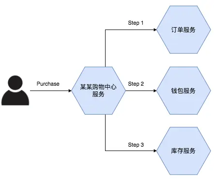
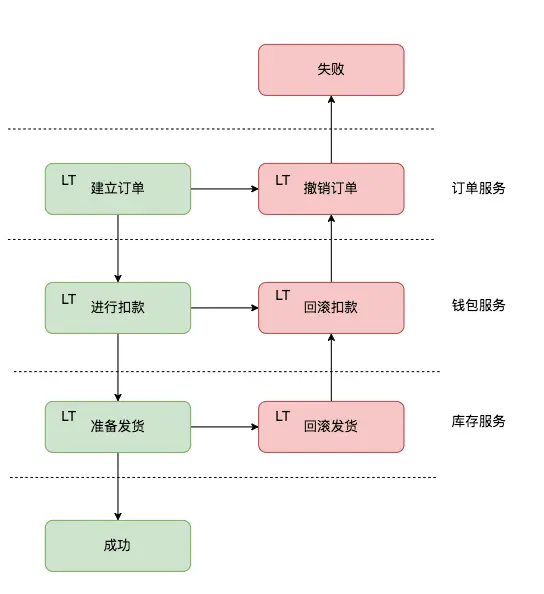
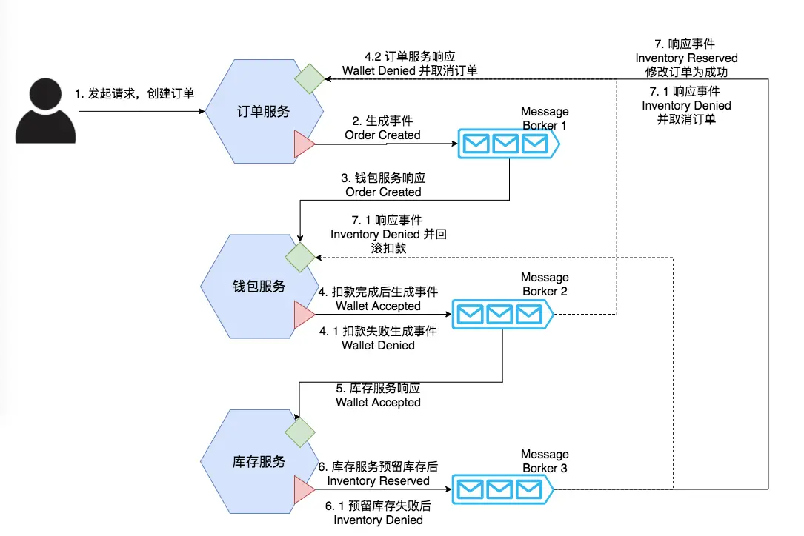

### 问题

当我们在开发单体应用时，其实我们对事务（即 transaction）的印象并不会很深刻，一方面是大多数工程师所开发的后端应用对一致性的要求并不是很高，很多时候只是封装一层 CRUD 的 RESTful 接口，另一方面则是单体应用在面对事务需求时，处理起来十分简单直接，往往依赖于数据库提供的标准事务就可以满足我们对一致性的要求。实际上，我们最常使用的事务严格来说应该是数据库事务，即 database transaction，而大多数一致性的需求（这与并发不相关），是通过数据库事务的 ACID 特性来进行管理的，因为数据库是进行数据存储的服务，而我们只需要数据提供数据上的一致性，所以满足我们的需求。但是，本文中提到的事务，多是指广义上的计算机事务，按照 Wikipedia 的定义，应该是如下的定义：

> Transaction processing is information processing in computer science that is divided into individual, indivisible operations called transactions. Each transaction must succeed or fail as a complete unit; it can never be only partially complete.

事务应是独立的、不可再分割的操作组合。每个事务中的操作必须全部成功，或者全部失败，部分成功是不允许的。事务常常用来解决系统的正确性，以及状态的一致。那么为什么我们需要在微服务的实现中强调事务的不同之处呢？原因很简单，微服务应用是由一系列的、松耦合的、独立的服务组成的应用，是没有一个中心的服务或者应用存储状态的，而数据库事务，在这个架构模式下，已经不可能满足需求。

比如我们要为用户生成订单并扣款，往往表现在代码层会是这样的情况：

1. BEGIN Transaction
2. 为用户创建订单，在 order 表中增加一条数据
3. 修改用户的 wallet 表中的数据，进行扣款
4. 联系库房，修改库存并进行发货
5. Commit

大约是这样的代码:

```java
@Transactional(rollbackFor = SomeException.class)
public BusinessResult purchase(final OrderRequest orderRequest) {
    // create order
    final Order order = orderService.createOrder(orderRequest);
    
    // change the balance in consumer's wallet
    walletService.minus(orderRequest.getConsumer(), order.total());

    // ask inventory to reserve items
    inventoryService.reserve(orderRequest.getConsumer(), order.getItems());

    return BusinessResult.SUCCESS;
}
```

如果在第三步用户的钱包中并没有足够的钱来支付订单，我们往往会结束事务，使用 rollback 回滚第二歩的操作，用户的订单就不会被创建了。所以，在单体应用中，我们往往使用代码和数据库提供的 transaction 就可以完成事务的需求。在 Java / Spring 世界中，使用 @Transactional 可以很方便的解决这个问题，对于其他语言和框架，也都有类似的工具。但是在微服务世界中，这一段代码就会有问题，因为不再有一个简单的 Annotation 就可以帮助我们实现事务了。

假设我们的服务逻辑架构是这个样子：




而在代码中，我们的 `orderService` `walletService` `inventoryService` 已经不是使用 DAO 去操作本地的关系型数据库了，而是使用 RestTemplate 或者其他工具分别访问对应的服务（当然可能会有断路器或者服务发现的 facade 等等，现实往往更复杂一些）。那么，我们面临的第一个问题就是：

如果 `walletService` 因为用户的金额不足，出现了扣款失败，返回了 Bad Request，那么已经创建的订单该如何取消？更糟的是，如果库存不足，我们需要回滚用户的扣款与订单，如果之前除了订单与钱包服务，还有其他的一些操作，我们通通都需要回滚。**因为我们需要保证数据的正确性，以及最终状态的一致。**

所以简单的来说，我们需要实现自己的事务模型来解决这个问题，而目前比较流行的就是 Chris Richardson 所推崇的 Saga Pattern。

### Saga

本质上来说，微服务对事务的需求分布式事务的一种体现，而问题就出现在服务和服务之间使用进程级别的通信，对于服务中的数据库来说，是不可以公开访问的，且况我们推荐不同的服务使用不同种类的数据库。所以通用的分布式事务的处理方式就很难以应用，比如在很多 NewSQL 实现方案中使用的两段式提交（Two-phase commit protocol）策略，例如（https://pingcap.com/blog-cn/percolator-and-txn/）。其他分布式事务模型，例如 JTA，则需要一系列的技术栈来满足，而且只限于 Java EE 应用程序，且况使用微服务的重要初衷就是解耦，我们并不想在一套通用的模型中限定自己的系统。虽然分布式事务很诱人，特别是 JTA 可以让程序员几乎无感知的使用分布式事务，但是代价十分巨大，这也就是为什么分布式事务在 NewSQL 这种底层存储层技术上应用的很好，但是在应用层，很少有人去实现。

Saga Pattern 和我之前使用过的补偿事务模式（Compensation Transaction https://docs.microsoft.com/en-us/azure/architecture/patterns/compensating-transaction) 很类似，简单来说，你必须自己显示的实现对事务回滚来保证正确性，所以称之为补偿事务。



所以 Saga 听起来很简单，我们可以用一堆本地事务（上图中的 LT，即 local transaction）自己去 rollback 之前的改动，对数据进行补偿，表达在代码上，大约是这个样子：

```java
public Result purchase(final Consumer consumer, final Order order) {
    final Either<Failure, Void> orderResult = orderService.createOrder(consumer, order)
            .flatMap(v -> walletService.minus(consumer, order.getMoney()))
            .flatMap(v -> inventoryService.reserve(consumer, order.getItems()));

    return orderResult.fold(this::handleFailure, v -> this.createSuccessResult());
}
```

在方法 `handleFailure` 中，**我们可以判断错误是在哪一步发生的，然后使用不同的补偿办法**，这样就能保证数据的正确性了。当然你可以使用更多成熟的手段去优化这一段代码，比如：可以将 Order 使用一个状态机来表达，使用 PENDING_MINUS、PENDING_RESERVE、PENDING_SHIP 这些字段来表示订单的情况。状态机可以很好的描述事务进行的状态，并且状态之间的改变是规定好的，方便操作和理解，最重要的是，状态机可以异步整个操作流程，你可以使用中间件将事件放入其中，然后使用其他的进程去修改状态。

以上的代码是一个还不错的 Saga 实现，但是在现实生活中往往不是，举个例子，在 `walletService` 中，我们会使用 RestClient 去调用后端的 `WalletService` 服务，不论是方法 `minus` 或者 `deposit` 都会进行这种昂贵的进程通信，而这些通信出错的可能性是大于单体应用之间的方法调用的。也就是说，你在考虑失败的时候，还需要考虑 `ROLLBACK` 操作时失败的情况，这是很常见的。

这种 Saga 也被成为编排式 Saga（Orchestration Saga），可以理解为是**显示的编排**，这也是很多同学在写服务之间调用时的基本做法，好处显而易见：

1. 事务非常简单，基本上是按照业务逻辑一路走下去，清晰直接。依赖服务也表述的很清楚，对于 purchase 的测试也就是一个单元测试。
2. 依旧强调了微服务的解耦，对于 purchase 这个方法，它并不需要关注 `walletService` 是怎么实现的，使用什么数据库，也没有事件在其中传递。
3. 比较符合人类习惯，这样来想，当客户点击购买按钮后，我们肯定希望客户收到的是`购买成功`这种结束的话语，而不`您的订单正在提交中`，给客户一个异步式的响应。

### 协同式 Saga (Choreography Saga)

与上文提到的编排式 Saga 不同，协同式 Saga 更像是转为分布式系统所设计的事务模型，使用 Event Trigger 的方式来进行事务的实现以及补偿出错的情况，或者可以称之为 Event Sourcing，只是在本例中，Trigger Transaction 是使用 Event 的一种方式罢了。

我们先来解释什么是 Event，Event 表示命令完成后的状态描述，例如 order_created 或者 items_reserved，这两个 event 分别描述在 OrderService 中创建了订单成功后发送的事件，以及 InventoryService 中成功的为用户保留了商品，准备发货。那么，我们就可以使用这些 event 来实现 Saga。



上面这个逻辑流程图看起很复杂，但是其实在现在流行的流式架构中非常常见，只是很多时候我们不使用 Event 来描述每个消息，而更多的是使用 Command。在今天，特别是 Apache Kafka 与 AWS Kinesis 这种现代的 Message Borker 可以帮我们轻松的实现事件的 pub-sub 模式，并且性能极佳。按照图上的描述，在第一步用户创建订单后，我们可以 OrderService 的数据库中表述订单为 Pending 状态，直到收到 Inventory Reserved 或者 Inventory Denied 这两个事件。

当然我们需要考虑这几个问题：

1. 首先每一步都必须是原子的，创建订单或者进行扣款都必须是原子操作，你依旧可以使用 local transaction 来实现这一点。并且需要考虑发布事件，Chirs 建议将发布事件放入本地的数据库事务中，我认为不一定，因为在提交时有时候会做 constraint 检查，如果失败，则需要 rollback，但是 publish event 是无法 rollback 的。
2. 事务的表达，我们需要一个类似于 transaction id 或者 order id 的标识来确保每一个服务，一般我倾向于 transaction id，这样可以将一堆不同服务上的操作串起来，或者这就是事务在协同式 Saga 上的唯一表达了。然后每个服务你都可以使用这个 ID 获取相关的数据，是否要做幂等或者 retry 取决于每个服务。
3. 技术栈与基础设施：目前有很多框架都可以支持这种流式或者 Event Soucing 应用，从 Ruby Sidekiq，Spring Kafka，Kafka Stream API，Apache Storm，AWS Lambda，Akka 等等，甚至你每个服务只要保证能订阅 Message Broker 就行了。但是对于基础设施来说，你必须有足够好的消息中间件，是因为这些服务都是松耦合的，使用一个巨型的 Kafka 集群虽然不会造成逻辑上的耦合，但是在部署架构上，是集中的，我倾向于 AWS Kinesis 或者是 N 个 Kafka，所以这取决于基础设施的能力。

当然，这种 Saga 的弊端也很明显：

1. 难以理解：我们没有一个地方能够表述 Saga 的全貌，所以对于开发人员是很难理解某一部分的代码是依赖于另一个服务的。
2. 紧耦合：每个服务都必须有要 Event Listener 与 Publisher，都是 Saga 中的一环，所以级联错误 cascade failure 是很容易出现的。
3. 最终状态：比如 OrderService 必须收到 Inventory Reserved 或者 Denied 才能保证订单的状态，那么如果收不到这两个事件，我们很难判断是下游出了问题，还是下游响应较慢。

所以，其实协同式的 Saga 并不是那么完美，具体的将这个架构实践时，你遇到的挑战肯定是大于 Chris 所提出的这些的，除了最终状态问题还有很多：比如前端业务逻辑是否允许显示 pending；或者如何监控事务的性能与成功率；如何处理这些失败的事务，使用死信队列还是等等；如何避免级联错误等等。所以大多数情况下，大家还是倾向使用编排式 Saga。

### Saga 的问题

按照 Chris 的表述，Saga 这种事务模型中 ACID 四种属性 Saga 只满足了 ACD 三种：

- Atomic: Saga 可以做到全部执行或者全部撤销
- Consistency: 本地事务保证了本地的一致性，服务直接的交互方式保证了整体的一致性（最终一致性）
- Durability: 本地数据库确保持久性

所以对于 Isolation，Saga 是没有任何机制可以确保的，那么这样会产生什么样的问题呢？参考以前我们在学习数据库隔离级别时的知识，很多问题是类似的：

- 覆盖更新：创建了 Order 后，正在继续下面的操作，这时候用户将 Order 取消，但是 Item Reversed 事件依旧会 Finish Order。
- 脏读：一个事务修改了数据，但是还未完成，另一个事务可以读取这个未完成的数据。
- 不可重复读：如果一个事务对数据进行了两次读取，结果不同。

在 RDBMS 中，使用不同程度的隔离级别就可以解决这些问题，比如 READ_COMMIT 或者 REPEATABLE_READ，往往我们不使用 SERIALIZABLE，这会极大的降低系统吞吐与性能，但是在 Saga 中，你必须想想其他的办法。当然最简单的方式可能就是加锁，比如在我们之前的状态机的例子中，PENDING_APPROVE 这个字段就可以被认为是一个锁。如果这个字段被事务所更改，表示这个事务已经完成，那么另一个事务就可以使用了。但是问题是，不论你使用哪种形式加锁，你都必须考虑等待或者死锁的问题，实现自己的死锁检测机制，这会带来很大的复杂度。当然还有一些其他实践方式，在此不再赘述，请参考 Chris 的博客与书籍。

另外，还记得我们使用悲观锁、乐观锁所解决的并发下一致性的问题吗？遗憾的是，在 Saga 中每个本地事务你都需要考虑，好在这种实现都很标准，也很简单。但是对于分布式下的一致性问题，所有的问题都需要具体分析与理解后再确认，比如在 NoSQL 下如何实现这两种锁呢？此外，对于 Sage 的框架 Eventuate Tram Sage，我建议接受使用这个框架的小组还是慎重，微服务本身就不强调银弹可以解决问题，而且 Eventuate Trem Saga 的 DSL 也让人生畏，是否采用这项技术还是取决于具体情况。

**没有银弹，没有银弹，没有银弹。**

### 参考资料
- https://microservices.io/patterns/data/saga.html
- https://github.com/eventuate-tram/eventuate-tram-core
- https://docs.microsoft.com/en-us/azure/architecture/patterns/compensating-transaction
- https://docs.microsoft.com/en-us/azure/architecture/patterns/cqrs
- https://docs.microsoft.com/en-us/azure/architecture/patterns/event-sourcing
- https://en.wikipedia.org/wiki/ACID
- https://en.wikipedia.org/wiki/Java_Transaction_API
