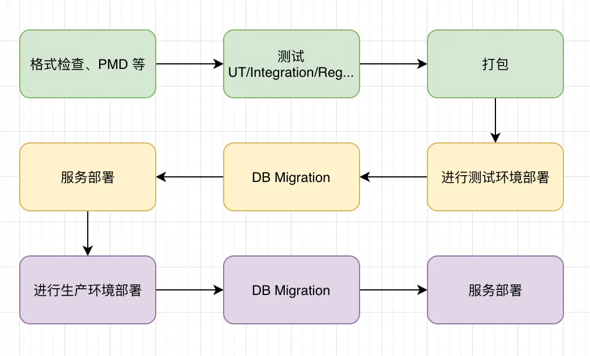

### 索引

#### 介绍
索引是数据库提供的一种能够快速查询数据的方法，一般来说索引记录了表中的一列或者多列的值与其存储位置的对应关系，有时候还有排序等，很多人比喻索引就像一本的书的目录一样，直接通过目录找到页码，这样你就能快速的找到自己想要的内容了（当然索引也有其他用处，比如唯一性的约束也很常见）。几乎所有的 RDBMS 都提供索引，我们可以通过建立索引对表中的数据进行查询或者排序，但是，代价是什么呢？

**1. 本质上索引是空间换时间，会增加存储空间**
**2. 在插入和修改数据时索引也会更新，这会增加这些操作的时间消耗**

不要小瞧索引的空间占用，特别是 RDS 中，某些情况下 Disk Space 会影响到 IOPS，所以可能你需要选择容量时考虑下索引的空间，**毕竟数据库扩容也是一件比较麻烦的事情**，以下是某个索引占用的空间描述：

```txt
oid          | 17461
table_schema | public
table_name   | messages
row_estimate | 9.14542e+06
total_bytes  | 123618959360
index_bytes  | 2265890816
toast_bytes  | 112305389568
table_bytes  | 9047678976
total        | 115 GB
index        | 2161 MB
toast        | 105 GB
table_bytes  | 8629 MB
```

PostgreSQL 支持这几种常见的索引：
1. **B-Tree：最常用的索引，处理等值查询或者范围查询，基本上 99% 的情况下都是用这个。**
2. Hash：可以做简单的等值查询（基本上用不到）。
3. GiST 与 SP-GiST：索引框架，可以在这种架构上实现很多不同的索引策略，基本上可以自己设计索引（比如地理范围搜索），SP-GiST 提供了一些新的算法用来提高 GiST 在某些情况下的性能（虽然很强大，但是笔者的场景决定笔者很少用到）。
4. GIN：反转索引，它可以处理多个键的值，常用它给数组类型建立索引（处理数组索引时会用到）。

在我们日常项目中，B-Tree 与 GIN 是都采用过的，但是这些年的开发中 GIN 索引也就使用过了一次。对于一个进行应用开发的工程师来说，有时候并不需要了解索引具体是如何实现的，但是你需要知道什么时候需要使用索引。关于 B-Tree 的介绍与特点可以参阅 wiki https://en.wikipedia.org/wiki/B-tree，我也比较好奇国内面试貌似挺喜欢问这个的。

#### 创建索引

那么什么时候需要创建索引呢？简而言之就是寻求功能与性能上的平衡。近年来存储空间的问题往往不需要考虑太多，毕竟磁盘已经很廉价了。如果你的应用是一个偏向查询的应用，那么对每个查询进行索引优化是非常值得的，毕竟通常情况下存储空间不是太大的问题，而且我们也不太在乎写入的性能。**但是如果你的应用有大量的写入、更新等操作，这时候创建大量的查询索引就需要考虑是否值得。**

**有时候我们常用备份恢复的数据库（或者临时表）进行业务数据的统计，这时候对于一些复杂的查询是可以通过索引进行优化的，建立索引再查询的效率远远大于直接查询，特别是对 JSON 内容的查询。**

不要对一些内容变化少的列建立索引，例如性别这种（只有男、女、其他），这种情况下应该考虑 partial index，例如：

```sql
CREATE INDEX male_author ON authors(name) WHERE gender = 'male';
```

很多表达式都可以写在索引中，例如我们希望对邮件进行小写字母的搜索，我们就可以对小写字母进行一个特定的索引：

```sql
CREATE INDEX users_lower_email ON users(lower(email));

SELECT * FROM users WHERE lower(email) = 'test@test.com';

CREATE INDEX book_created_at_index ON books(date(created_at));

SELECT * FROM books WHERE date(created_at) = date('2019-03-07');
```
注意date 的例子，这个索引比直接对 timestamp 建立索引要高效。

针对不同列的查询，推荐建立多列的索引，对于有排序的情况，排序索引也是可以的：

```sql
CREATE INDEX CONCURRENTLY IF NOT EXISTS "itemEvent$partial_localEventTimestamp"
ON item_event(local_event_timestamp DESC)
WHERE event_type = 'removeAnnotation'
    AND event_seq > 246500000;
```

#### 并发创建

我们经常会发现意料之外的由 SQL 引起性能问题，大多数是因为查询时间过长，这自然很影响用户体验。可能的原因是一开始我们忽略了某个 SQL 的优化，或者估计错了数据量，或者数据的增长超过我们的预料等，这些情况基本上每个工程师都遇见过。解决方法也很简单，如果是查询数据库引起的性能问题，那往往增加索引那就是第一选择了。但问题就在执行那句简单的建立索引的语句上了，因为创建索引常常会阻止其他的一些数据库常规的操作，**PostgreSQL 需要阻止所有对目标表的写操作，然后进行一次全表扫描去建立索引，所以在这个时候，你的 insert\update\delete 语句都会被阻塞**。

当然，在我们的数据量不大的时候，全表扫描花不了多少时间，或者系统并没有写操作的时候，我们也不会在意是否需要锁表去建立索引。但是对于一个生产环境的下的应用，锁表基本上也就表示很多功能不可用了，这会极大的影响到用户体验，也会让数据库的变更非常昂贵。我想每个人几乎都会有半夜进行数据库变更的操作，我们会疲惫不堪，并且面带血丝，然后担心是不是自己做错了什么。

简而言之，我们现在已经有很多的手段实现持续交付，特别是微服务化已经可以让我们做到一天部署好几次自己的代码到生产环境了，我们自然不想让数据库的变更成为持续交付的障碍，那么你就需要考虑使用并发创建索引这样类似的功能，甚至在 CI 中进行数据库的变更。**当然有能力的进行非阻塞的变更是一个极大的好处，但并不是说我们需要经常使用到这个功能，我们依旧需要认真设计自己的数据结构，认真考虑系统中的每一条查询，因为数据结构在存储层的变更成本还是大于软件本身的成本的。**

对于 PostgreSQL 来说，并发创建索引时非常简单的，只需要在 `CREATE INDEX` 上加上 `CONCURRENTLY`， 这时 PostgreSQL 会进行两次的全表扫描去等待正在执行的 transaction 完成，这些 transaction 一般只有那些可能会使用或者修改索引的事务。所以显而易见的是，使用 `CONCURRENTLY` 比普通的创建索引的方式慢的多，也会增加一定的 CPU 与 IO 负载，那么自然也会影响到数据库的性能。那么，对于并发创建索引，我们应该注意什么呢？

```sql
CREATE INDEX CONCURRENTLY IF NOT EXISTS "itemEvent$partial_localEventTimestamp"
ON item_event(local_event_timestamp DESC)
WHERE event_type = 'removeAnnotation'
    AND event_seq > 246500000;
```

1. 对于任何的 DDL 操作，你都需要评估这个操作在生产环境中情况，包括：步骤、时间、影响性能、有无阻塞、风险等，即使 `CONCURRENTLY` 可以带来非阻塞，但是数据库的性能却会受到影响，所以你**肯定不希望这个事情在系统繁忙时发生。**
2. 不论 DDL 操作在哪里执行，**都需要考虑改变过的 schema 是否与当前代码版本兼容**，有时候 migration 很顺利，但是因为疏忽忘记了当前的代码还是老代码，而这种情况下又无法回滚程序，那基本上就是级别较高生产环境错误了。虽然这个问题很初级，但是有些团队不一定有较强的数据库能力，失去了对 DB 的敬畏也是很危险的。
3. 任何时候都需要考虑 rollback 或者错误补救方案，并且在补救方案中，每一步都必须是**简单的、命令式**的语句。如果你需要手动的进行数据库操作，那你就一定需要考虑自己的退路，**一般来说人在面向错误时会慌乱**，这时候再进行操作很容易会造成更严重的二次破坏。

### DB migration for normal developer

这里我想说说跟 PostgreSQL 无关的事情，即 migration。我们与数据库的关系在改变，以前可能一个公司就一个数据库（它可能是分布式的或者是小型机上的），然后我们会雇佣薪水高的吓人的 DBA 去照顾好这个最重要的资产（因为数据是最重要的资产），这个 DBA 或者 DBA 团队会满足我们的一切数据库需求，例如帮我们建表、建索引，帮我们处理复杂查询、优化性能，或者帮我们编写复杂难懂的存储过程，这种方式是传统单块架构的典型的最终形态，强大的商用数据库在这一层就能解决很多业务问题，即使它有着难以维护、难以测试等问题。还记得我们为什么要走微服务化吗？很重要的原因是，单块应用呆板、脆弱、难以修改维护，并不能很好的适应现在基础设施的进步，我们推荐使用“笨拙”的中间件来代替复杂的、可怕的 ESB，我们也希望能够根据业务选择不同的数据存储技术，并且将存储封装在服务的边界之内。无论怎么样，现在轮到一般的开发人员进行数据库操作了，如果微服务转型的拆表做的很好，你的每个小服务应该没有几张表来存放你的数据，基本上很难有三张表以上 join 的场景了，但即使是这样，你也需要建表，建索引，创建用户或是进行表结构的修改，我们将这些步骤一般称作 DB migration，这与 data migration 不同。

#### 编写

几乎所有的 web 框架都提供了进行 DB migration 的工具或者能力，笔者使用过 active record、php Laravel、flyway、Liquibase 等等，也有一些 ROM 自带的工具，这些工具都有类似的能力：在特定的时刻被触发，然后执行我们的 plan 对数据库进行修改，并且记录版本，如果出现错误也可以根据我们的预设进行回滚。目前进行 plan 编写有 DSL 的方式或者 RAW SQL，大约是这样：

这是一个典型的 DSL 的 migration plan 的一部分：
```ruby
class CreateApiConsumers < ActiveRecord::Migration
  def change
    create_table :api_consumers do |t|
      t.string :name, null: false
      t.string :token, limit: 32, null: false
      t.string :description
      t.timestamps
    end
  end
end
```

或者这种：
```sql
CREATE TABLE item (
   id UUID NOT NULL,
   resource_id VARCHAR(128) NOT NULL,
   resource_type VARCHAR(128) NOT NULL,
   updated_at TIMESTAMP WITH TIME ZONE NOT NULL DEFAULT now(),
   created_at TIMESTAMP WITH TIME ZONE NOT NULL DEFAULT now(),
   CONSTRAINT item$pk PRIMARY KEY (id)
);
```

我是推荐第二种方式的，**首先 DSL 并不能完全正确的使用数据库的特性**，这取决于 DSL 的编写能力和数据库驱动的功能支持，例如 `Active Record` 就无法异步并行的创建索引；然后 DSL 并不能直接对应具体做了什么，我们都知道 ROM 可能去做一些额外的事情比如获取 schema 创建数据结构等，所以你很难确定 DSL 式的 migration 到底做了什么，不确定就会出现风险；因为 DSL 的功能是受限的，甚至有时候你需要再写一些 SQL 来实现自己的想要的功能，维护性下降；最后，很多团队使用 DSL 更多的是想解耦数据库（同样的 DSL 配合不同的驱动操作不同的数据库），即线上 MySQL，开发 H2 或者 SQLite，诚然这对开发非常友好，但是如果你的服务依赖一些数据库的特性，或者一些数据结构其实并不兼容，那么这是极度危险的，我们推荐在任何时候都应该优先考虑能否创造对等的开发环境。

当然，如果你的 migration 是有很多创建表的话，往往并不会有太大的问题，但一旦牵扯到修改的 DDL：例如增加索引、增加新列或者修改名称这种操作，都是我们常说的"破坏性"的操作，**破坏性的操作大多数情况是与代码不兼容，或者发生了意外的锁表**，比如这个例子：某同学为某表创建了索引，并且在本地、测试环境都进行了测试，十分顺利，因为这个索引并没有修改表结构，所以并不担心会对线上造成问题，但是他忽略了线上数据库的流量是远远大于本地与测试环境的，而创建索引则会进行表锁定，导致写阻塞，从而造成了运营事故。编写 migration 脚本时，也要考虑错误处理，或者 rollback。很多框架都提供了这样的功能，你可以编写 up 来进行正向的 migrate，然后 down 进行撤回。这个规则很简单，出现了错误就执行 down 中的命令。但是，**这一点也需要慎重考虑**，有时候的 down 可能是删除表，或者移除列，这会造成意外的数据丢失。

最后我强烈推荐将 migration 的脚本 check-in 到代码库，保证不论是哪个环境的数据库，都必须执行完全一样的代码，**尽量不要使用不同的环境变量去创造 if-else 的逻辑，例如 prod 或者 preprod**。另外，我们 db migration 往往是追加的，而不是修改，也请考虑脚本的精简与描述准确，我曾经见过类似于 `v96_add_index_for_new_tables.sql` 这样的文件，这样的文件名几乎没有任何描述意义，请问在 96 次修改后，我怎么知道哪些表是 `new_tables`？或者，你真的需要 96 次修改？我觉得这时候我们需要进行一次整理了。

#### 测试

这里的测试是指开发人员的测试，我们鼓励开发人员去进行测试去获取更快的反馈，这样对项目质量会有很大的提升。对于 migration plan，我们在测试时，需要确保：

1. 目标数据库是否和线上数据库一致？
如果你本地有版本一致的数据库运行，那这一条基本上没什么问题。如果没有，而且你不想装太多的数据库服务的话，可以考虑使用 docker，我们常常使用 docker-compose 创建 dev 环境，它可以很方便的帮你启动数据库实例，并且运行 migration，甚至你可以将示例数据导入其中，而且也不会让你的笔记本电脑装满各种各样的 daemon。最重要的是，它几乎可以帮你找到任何版本的数据库，特别是 MySQL 与 PostgreSQL。

2. 所修改的数据结构，与现在运行的版本是否兼容？
这就是我们鼓励 dev 进行测试的另一个原因，往往开发人员很清楚的知道自己修改了哪些地方，那么他就会知道需要测试哪些可变的部分。如果你的交付单位是一天一次或者几次，你是几乎没有可能去进行回归测试的，所有的测试就是基于可变以及程序设计时的边界隔离。我们鼓励小步提交或者小步交付，也就是说，你要很清楚的知道，需要测试的是哪个版本。

3. 演练 migration 失败
"任何时候都需要考虑失败"，这是我的前辈很早以前告诉我的一句话，即使我的工程经验已经很丰富了，我也不想在数据库变更时放水。所以，在进行测试的时候最好考虑或者实践一下那些会导致失败时的 case，这会让我们面对异常时不那么慌乱。

#### 运行

我理想中的进行数据库变更是发生在 CI 中的，而且是在应用部署之前完成，我们可能会有这样一段 pipeline：


（仅供举例，不代表真实情况）

1. 尽量避免手动的去“触碰”数据库

不论是最小权限原则还是数据安全或者是公司的规则，我一直反对可以直接接触到生产环境数据的情况，虽然这样会丧失一定的灵活性，但是数据作为最重要的资产，而操作数据的只有程序，而不是人。人需要程序去操作数据，而为程序的质量负责的是小组，组织会阻止部分的人为因素，降低人犯错的概率。在线上数据库上，这样的错误我认为是很难承受的，例如 Gitlab 这样的[事件](https://about.gitlab.com/2017/02/01/gitlab-dot-com-database-incident/)。既然进行 migration 都已经程序化了，还有什么理由自己去手动的执行呢？

跳板机也是比较危险的存在，因为这破坏了生产环境的边界，但是本文不讲太多安全方面，所以也是不推荐的。

2. 可以在应用程序启动前去做吗？

我们在程序启动时进行 migration 是一个常见的做法，特别是 flyway 或者 Liquibase 都支持这一套做法，毕竟简单。但是我们还是推荐稍微麻烦一些使用 out-of-process 的方式进行（即使应用和 plan 都是在一个 codebase 中）。好处是：
- 我可以知道 migration 的具体情况，时间，完成后的输出是否符合预期等，往往这些信息存在在 log 中，和应用程序并没有关系。
- 第二，如果 migration 需要的时间很长，我们就不需要部署应用程序，不会出现程序启动了三十分钟 migration 还没做完的情况。
- 对于微小的改动，我们改了数据库又加了一些代码，我们可以做一个 pull request 并进行一次部署，这样的 pipeline 可以做到先 migration 再部署代码。
- 还有就是可以动态的调整 pipeline，如果这次的代码修改只是 migration，那我自然就不会部署应用了。
- 最后，如果部署应用程序是启动多个实例或者容器的话（这太常见了），那么请问哪个实例或者容器上的进程是在进行 migration 呢？那其他的进程是直接工作呢还是大家一起等？这种复杂度不是我们愿意面对的。
