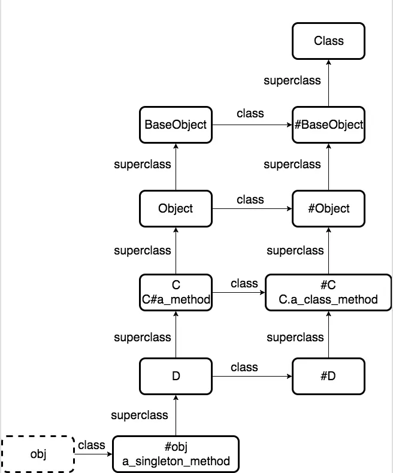

最近复习了下 ruby 对象模型的知识，参照了 Ruby Metaprogramming，于是边看边做笔记，还是收获很多。

### Open Class
```ruby
class String
  def my_method
    "#{self} length is #{self.length}"
  end
end
```

class 更像是一个作用于操作符，而不是声明语句。

**创建类是一个令人愉快的副作用**。

class 关键字的核心任务式把你带到类的上下文中，让你可以在里面定义方法。使用它可以打开类，进行动态修改。

### Inside the Object Model

对象包含实例变量，可以使用 `Object#instance_variables` 查看

类的名字是一个常量

对象的类和实例变量并没有关系，给它赋值的时候，它们就出现了。每个对象的实例变量不同。

解释器中，一个对象仅仅包含它自己的实例变量，以及一个对自身 Class 的引用。

为了共享，方法必须存放在类中，而非对象中。

```ruby
String.instance_methods == 'aaa'.methods # true
String.methods == String.instance_methods # false
```

**类本身就是对象，是 Class 类的实例。**

```ruby
Class.instance_methods(false) # [:allocate, :new, :superclass]
```

如果你希望代码被 include 进去，就用模块，如果你希望某段代码被实例化或者继承，就应该使用类。

```ruby
[].class.class # Class
[].superclass # Object
```

### Constant and path

帮助我们找到常量、类等。:: 表示 root-level。

```ruby
module M1
  class C1
    X = 'constant'
  end
  C1::X
end

M1::C1::X

:: # root-level

Y = 'root-level constant'

module M
  Y = 'constant in M'
  Y
  ::Y
end
```

`Module.nesting` 表示当前路径。

### Objects and Classes 小结

什么是对象，对象就是一组实例变量和一组指向其类的引用。

对象的方法并不存在与对象本身，而是存在与对象的类中。在类中，称为实例方法。

类是一个对象 （ Class 类的一个实例）外加一组实例方法和一个对超类（Superclass）的引用。Class 类是 Module 类的子类，所以类也是一个模块，但是你不能 include，也不能 prepend 类。

以下一个很著名的 pattern，用来实现类，可以思考这样做的目的是什么。

```ruby
module Hello
  module ClassMethods
    def class_m
      'ClassMethods'
    end
  end
  
  module InstanceMethods
    def instance_m
      'InstanceMethods'
    end
  end
  
  def self.included(receiver)
    receiver.extend         ClassMethods
    receiver.send :include, InstanceMethods
  end
end

class C
  include Hello
end
```

### Method lookup

ruby 进行方法查找遵循向右，向上的原则。

**receiver 是调用方法的对象，明确方法的 receiver 是非常重要的。**

ancestors 是祖先链，表示继承关系。ruby 先在接受者中查找方法，再沿着祖先链向上查找，直到找到为止。

```ruby
module M1, Class C,

C include M1

Class D < Class C

D.ancestors # [C, M1, Object, Kernel, BaseObject]
```

M1 M2 谁 include 在前，就在 ancestors 的前面。

```ruby
C include M1
C include M2
C.ancestors # [C, M2, M1, Object, Kernel, BaseObject]
```

而 prepend 将会导致如下：

```ruby
C prepend M1
C.ancestors # [M1, C, Object, Kernel, BaseObject]
```

如果一个类或者模块已经出现在祖先链中，将会忽略 prepend 与 include。

**Kernel Module** 提供内核方法，被 Object include。你当然可以用它做点“坏事”。

### Self

Ruby 中每一行代码都会在一个对象中被执行，**当前对象用 self 表示，也可以用 self 对其进行访问**。

private 关键字只能被隐形的 self 调用。

私有规则：如果接受者不是自己，就必须指明接受者；私有方法只能被隐性的接受者调用；

私有方法可以被继承。

```ruby
# main - top level context

irb -> self # => main
self.class # => Object
```

一个私有规则的例子：

```ruby
class Klass
  def method_a
    method_b
  end

  private

  def method_b
    'hi'
  end
end

Klass.new.method_a

class Klass
  def method_a
    self.method_b
  end
end

Klass.new.method_a

# NoMethodError: private method `method_b' called for #<Klass:0x007fd0d50ad428>
```

因为不满足私有规则，所以丢出 NoMethodError 的错误。

在上面这个例子中，如果不使用 `self.class` 的话，会发生什么后果？

```ruby
class Point
  attr_reader :x, :y

  def initialize(x, y)
    @x, @y = x, y
  end

  def +(other)
    self.class.new(@x + other.x, @y + other.y)
  end

  def -(other)
    self.class.new(@x - other.x, @y - other.y)
  end

  def to_s
    "{#{@x}, #{@y}}"
  end
end
```

### Refine

Refine 是用来代替猴子补丁的一种做法，也不能完全替代猴子补丁。
```ruby
module StringExtensions
  refine String do
    def my_length
      "#{self} length is #{self.length}"
    end
  end
end

module StringStuff
  using StringExtensions  
  'foo'.my_length
end
```

在两种情况下会起到作用：
1. 在 `refine block` 内部
2. 从 `using` 开始到模块结束，或者文件结束

这里有个很有意思的例子说明 refine，可以猜猜输出是什么。

```ruby
class MyClass
  def my_method
    'original'
  end

  def another_method
    my_method
  end
end

module MyClassRefine
  refine MyClass do
    def my_method
      'refined my_method'
    end
  end
end

module Run
  using MyClassRefine
  p MyClass.new.my_method # ???
  p MyClass.new.another_method # ???
end
```

### Dynamic Methods & Dispatch

`Object#send` `Object#public_send` 帮助我们实现了 dynamic dispatch，是一种很好用的反射方式。

`Module#define_method` 帮助我们动态的创建方法。书上最后的例子是非常值得学习的，请牢记我的 comments。

```ruby
class Computer
  def initialize(computer_id, data_source)
    @id = computer_id
    @data_source = data_source
    data_source.methods.grep(/^get_(.*)_info/) do # 使用内省的方式自动创建，进行部分解耦
      self.class.define_component $1 # 使用 self.class 避免子类丢失方法
    end
  end

  def self.define_component(name)
    define_method(name) do
      # dynamics dispatcher # 动态的调用
      info = @data_source.send "get_#{name}_info", @id
      price = @data_source.send "get_#{name}_price", @id
      result = "#{name.capitalize}: #{info} (#{price})"
      price >= 100 ? "* #{result}" : result
    end
  end
end
```

### Ghost Methods

`BacisObject#method_missing` 是当没有按照向右，向上查找后调用，参数为 (method, *args, &block)，Ruby 很灵活，这个表示如果没有找到你的方法，那就调用这个，所以可以 override 这个家伙帮我们制作那些并不存在于 `Object#methods` 的方法。

`BacisObject#method_missing` 也可以用其来实现动态的方法**调用**，注意不是**定义**。

所以 ghost method 并不是真正的方法，我们知道当你通过 `Object#response_to?` 查询一个方法时，将会返回 true，而对于 ghost method，将会返回 false。而 response_to 将调用 response_to_missing，所以千万不要忘记要重现 response_to_missing。

我非常喜欢下面的例子，可以想想如果没有 number = 0 将会发生什么。Ghost Methods 十分强大，所以一定要小心，don't break anything。

```ruby
 def method_missing(name, * args)
    person = name.to_s.capitalize
    super unless is_our_member? person
    number = 0
    3.times do
      number = rand(10) + 1
      puts "#{number} ..."
    end
    "#{person} got a #{number}"
  end
```

Ghost Methods 产生风险的原因是他们并非真正的方法，只是对方法的**拦截**。你有很多规避放的地方，比如必须要调用 super；还需要更新 responsd_to_missing?。使用时，牢记那个有意思的 bug。

Dynamic Methods 就是真正的方法，只是定义的方式不一样罢了。

某时，你只能使用 Ghost Methods，例如 JSON 库，你无法确定有多少种标签你需要支持。对于 DAO 的话，根据 table schema 可以简单的使用 define_method 生成你想要的方法。

在可以使用动态方法的时候，使用；除非必须使用 Ghost Methods，否则尽量不使用。

### Blocks Are Closures

代码块即**包含了代码，也包含了一组绑定**。代码库在定义时，获得定义中的绑定，运行时，带着绑定进入该方法。

```ruby
def my_method
  x = 'good bye'
  yield('cruel')
end

x = 'hello'
my_method {|y| "#{x},#{y} world" }
```

代码块获取局部绑定，一直携带着这些绑定。在 JavaScript 中，我们往往这样描述闭包：闭包是一个拥有许多变量和绑定了这些变量的环境的表达式（通常是一个函数），因而这些变量也是该表达式的一部分。牢记执行的代码以及携带的绑定可以帮你解决很多问题。

提到闭包，就不能不提到作用域 Scope。只要程序切换了 Scope，有些绑定就会被新的绑定所取代。

程序会在三个地方**关闭**前一个作用域，同时**打开**一个新的作用域：类定义，模块定义，方法。

在 class/module 与 def 之间还有一个小区别，在类定义与模块定义中的代码会**立刻执行**（这是很多 Java 程序员很难理解的地方），例如：

```ruby
class B
  def self.some
    'bar'
  end

  some #=> bar
end
```

下面使用 Class.new 中的 block 穿越作用域，来达到扁平作用域的作用，使用闭包穿越作用域 ，在 Class.new 中，调用到另一个作用域里的变量。可以试试如果使用 `class` 关键字，该怎么办。

```ruby
my_var = "Success"

MyClass = Class.new do
  puts "#{my_var} in class"

  define_method :my_method do
    puts "#{my_var} in my_method"
  end
end

MyClass.new.my_method
```

### Proc & Lambda

你可以把 `block` 传递给 `Proc.new` 方法来创建一个 `Proc` 对象，然后使用 `Proc#call` 来执行，技巧叫做 Deferred Evaluation，也叫做 Lazy Loading。如果你对函数式编程比较熟悉的话，这个概念应该不陌生。

有两个内核方法可以把 block 转换为 Proc：proc & lambda。

```ruby
p = lambda { |x| x + 1 }
p = -> (x) { x + 1} # 简写
```

& 操作符的意思是，这是一个 block 对象，我想把它当做 block 来使用，去掉 &，就会得到一个 block 对象，例如：
```ruby
class C
  def foo
    'foo'
  end

  def bar(&block)
    block.call
  end
end

c = C.new
m = c.method :foo
c.bar m # error!
c.bar &m # to block
c.bar do
  'hi'
end # hi
```

proc 和 lambda 的区别:

区别1： return 是从定义 proc 的作用域中返回， lambda 则表示在 lambda 中返回。
区别2： lambda 的参数数量是严格的，更像是方法。

```ruby
def method_a(callable)
  callable.call * 2
end

p = proc { return 10 }
method_a p # error

p = proc { 10 }
method_a p

p = lambda { return 10 }
method_a p
```

### Method 对象

可以使用 `Object#method` 方式获取 method 对象。

method 对象是可以被执行的，`Method#call` 将会执行，参看 [Duck Typing](https://en.wikipedia.org/wiki/Duck_typing)。method 对象可以通过 `Method#to_proc` 转为 Proc。

proc，lambda 是在定义的作用域中执行，而 method 对象是在自身所在对象的作用域中执行。

```ruby
class Foo
  def bar(&callable)
    callable.call
  end

  def some_method
    x
  end

  def x
    'xxx in Foo'
  end
end

x = 'xxx'
m = proc do
  x
end

f = Foo.new

f.bar &m
f.bar &(f.method :some_method)
```

### Class Definition Demystified

我们可以在类定义中放入任何代码，最后一条语句就是返回值。

在定义（模块）时，类本身就是当前对象的 self，类和模块也是对象，所以类是可以充当 self 的。self 是当前的对象。

- 在程序顶层，当前类是 Object，是 main 对象所属的类
- 在方法中，当前类就是当前对象的类。
- 使用 class 或者 module 打开时，所打开的类是当前类。

```ruby
class C
  def m1
    def m2
    end
  end
end

class D < C
end

c.instance_methods false # => :m1 在此时，并没有执行 m1, 则只有 m1
D.new.m1 # => 执行了 m1, 但是 m2 定义在了 C 上
c.instance_methods false # => :m1, :m2
```

另一个例子：

```ruby
def add_method(klass)
  puts self #  => main
  klass.class_eval do
    puts self # => String or other class
    def m
      puts self # => instance
      'hello'
    end
  end
end

add_method String
```

- 所有使用 def 定义的方法都是当前类的实例方法
- 在类的定义中，当前类就是 self —— 正在定义的类
- 如果有引用，则可以使用 class_eval 打开这个类，self 则会被修改

Ruby 解释器假定所有的实例变量都属于当前对象 self，所以在类定义中，我们是可以使用 @ 的。@x 为类实例变量 **Class Instance Variables**。只能被自身访问，不能被类的实例或者子类所访问。

```ruby
class MyClass
  @x = 1
  def self.read
    @x
  end
end

MyClass.read
```

### Singleton Methods & Objects

我们之前提到，可以单独的为一个对象增加独有的方法，例如：

```ruby
str = 'sss'

def str.foo
   "bar #{self}"
end
```

现在问题来了，这个方法在哪里？按照之前提到的方法查找，我们应该去查找的是 `String#foo` ，但是其中并没有定义这个方法。答案是，这个方法会被放在了 [单例类](https://www.devalot.com/articles/2008/09/ruby-singleton) 中。

那么以前我们提到的类方法是什么呢？也许你已经明白了，类是一个对象，是 Class 的对象。所以类方法的本质是：它就是一个类（class 对象）的单件方法。

```ruby

class C
  def a_method
    'C#a_method'
  end
end

class D < C

end

obj = D.new

p obj.a_method # => C#a_method

class << obj
  def a_singleton_method
    'obj#a_singleton_method'
  end
end

p obj.a_singleton_method # => "obj#a_signleton_method"
p obj.singleton_class # => #<Class:#<D:0x007fe5c605ec50>>
p obj.singleton_class.superclass #=> D

class C
  class << self
    def a_class_method
      'C.a_class_method'
    end
  end
end

p C.a_class_method # => 'C.a_class_method' 
p D.a_class_method # => 'C.a_class_method'

p C.singleton_class # => #C
p D.singleton_class # => #D

p D.singleton_class.superclass # => #C
p C.singleton_class.superclass # => #Object
```

所以我们修改了方法查找：



```ruby
Object.singleton_class => #Object
Object.singleton_class.superclass => #BaseObject
Object.singleton_class.superclass.superclass.class => Class
```

归根结底，我们补充了 Ruby 的对象模型，并且给出了最重要的 7 条规则：

1. **只有一种对象——要么是普通对象，要么是模块或者类**
2. **只有一种模块——普通模块、一个类或者单件类**
3. **只有一种方法，存在于模块中——通常在类中**
4. **每个对象都有自己的“真正的类”——要么是一个普通类，要么是一个单件类**
5. **除了 BaseObject 没有超类，每个类都有且只有一个祖先**
6. **一个对象的单件类的超类是这个对象的类，一个类的单件类的超类是这个类的超类的单件类**
7. **调用一个方法，Ruby 先向右去找接收者真正的类，再向上查找**
